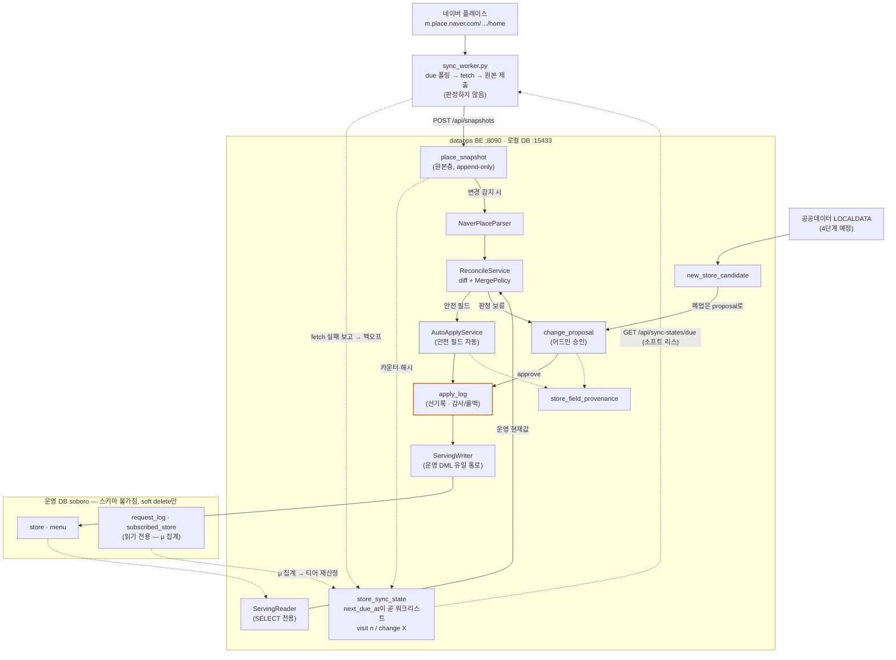

# 데이터 최신화 설계서 (v2)

> 작성 2026-07-31 · 구현 기준 문서
> 근거 문서: [데이터 최신화 설계 노트](./데이터%20최신화%20설계%203ad049a0727b809b8311f91235dbd971.md)(구조 초안) · [리서치 보고서](./data-freshness-research.md)(이론·실측)
>
> **v2 전제 (v1과의 차이):**
> 1. 이 레포의 기존 도메인 4개(issue·ingest·remedy·crawltask)와 그 테이블·스크립트는 **전부 폐기** — 어떤 신규 설계도 이를 참조·확장하지 않는다.
> 2. 운영 데이터 반영은 admin API 경유가 아니라 **운영 DB 직접 쓰기(DML)** 로 한다.

---

## 1. 전제와 원칙

1. **크롤러는 판정하지 않는다.** 크롤러(Python 워커)는 원본 페이로드를 서버에 제출할 뿐, 무엇을 반영할지는 서버 판정층이 결정한다.
2. **최신화 상태는 전부 dataops 로컬 DB에 산다.** 운영 DB에는 **스키마 변경 0, DML만** — 그것도 판정층을 통과한 것만.
3. **운영 DB 쓰기는 전부 기록을 남긴다.** 모든 직접 쓰기는 `apply_log`(변경 전/후 값 포함)에 남아 롤백·감사가 가능해야 한다. 물리 DELETE 금지, soft delete만.
4. **모집단 분리** (리서치 1.7): 미매칭 32%는 매칭 트랙(보류), 나머지 매칭 가게는 이 시스템의 대상. 메뉴 0개 backfill은 별도 경로가 아니라 **같은 파이프라인의 "신규 메뉴 자동 추가"** 로 흡수된다 — **첫 전체 스윕이 곧 백필 스윕이다.** (리서치 2.5 실측: 누락 메뉴의 68.8%가 노후화가 아니라 최초 수집 누락. 메뉴 0개 가게의 47.7%(~3,170곳, ~32,000메뉴)를 무료로 채울 수 있다)
5. **스케줄은 단순하게 시작한다.** μ 신호 보유 가게 2.7%(리서치 3.5), Δ 데이터 0 — 배분 공식은 보류하고 티어 기반 균일 주기. 단 Δ 추정용 카운터(n, X)는 지금부터 쌓는다.
6. **자동 반영은 좁게, 승인은 넓게 시작한다.** 필드별 병합 정책(5장)으로 안전한 것만 자동, 나머지는 `change_proposal` 승인.

---

## 2. 전체 아키텍처



### 데이터 흐름

**A. 주기 재동기화 (본체) — 작업 큐 없음, `store_sync_state`가 곧 워크리스트**
1. `sync_worker.py`(requests 기반, 브라우저 없음 — 리서치 2.2 실측 근거)가 `GET /api/sync-states/due`를 폴링 — 서버는 due 목록을 반환하며 `last_attempt_at`을 스탬프(소프트 리스: 최근 배부분은 due 쿼리에서 제외)
2. 워커가 가게마다 네이버 플레이스 페이지 fetch → **원본 그대로** `POST /api/snapshots` 제출. fetch 실패는 `POST /api/sync-states/{id}/failure`로 보고(→ 백오프)
3. `SnapshotCommandService`: SHA-256 해시 → 직전과 동일이면 insert 생략(방문 카운터만) / 변경이면 저장 + 판정 트리거
4. `ReconcileService`: 파싱 → `ServingReader`로 운영 현재값 조회 → 필드 단위 diff → 병합 정책 → 자동 반영(`ServingWriter` + provenance + apply_log) 또는 `change_proposal` 생성
5. 성공 처리(`recordSuccess`)가 next_due_at을 재계산 — **별도 스케줄러·클레임·복구 로직이 없다.** 워커가 도중에 죽어도 안 긁힌 가게는 due로 남아 다음 폴링에 다시 나온다. 중복 배부가 나도 크롤은 멱등(스냅샷 해시 dedup)이라 1.5초 낭비가 전부다

**B. 승인 워크플로**
어드민이 `GET /api/proposals?status=PENDING` 검토 → approve 시 `ServingWriter`로 반영 + apply_log + provenance 기록 → APPROVED. reject 시 사유와 함께 REJECTED. 같은 대상에 새 diff가 오면 기존 PENDING은 SUPERSEDED.

**C. 신규 가게 발견 (4단계 파일럿 이후)**
공공데이터 주기 pull → 신규 인허가 `new_store_candidate(WAITING_NAVER)` 적재 → 워커의 매칭 모드가 `GET /api/candidates?status=WAITING_NAVER`를 폴링해 네이버 매칭 시도 — **candidate.status 자체가 워크리스트라 여기도 큐가 없다** → 매칭+크롤 성공 시에만 운영 store INSERT. 폐업 레코드는 `change_proposal(target=store.status)`로.

---

## 3. 테이블 스키마 (dataops 로컬 DB, Flyway)

> 기존 마이그레이션 3개(data_issue·remedy_execution·crawl_task)는 폐기 — 4.1 정리 절차 참조.
> 컨벤션: `TIMESTAMP`(TZ 없음) · `BIGSERIAL` · VARCHAR enum · `created_at/updated_at DEFAULT now()`.
> 운영 DB와 물리 분리이므로 `store_id`·`menu_id`는 FK 없이 논리 참조.

### 3.1 `store_sync_state` — 가게×소스 동기화 상태 (이 테이블이 곧 워크리스트다)

```sql
-- V20260801100000__create_store_sync_state.sql
CREATE TABLE store_sync_state (
    id                   BIGSERIAL PRIMARY KEY,
    store_id             BIGINT      NOT NULL,      -- 운영 store.id (논리 참조)
    source               VARCHAR(20) NOT NULL,      -- NAVER | LOCALDATA | INSTAGRAM
    external_id          VARCHAR(80),               -- naver_place_id, 인허가 관리번호, 인스타 핸들…
    tier                 VARCHAR(10) NOT NULL DEFAULT 'T1',      -- T0 | T1 (6장)
    state                VARCHAR(20) NOT NULL DEFAULT 'ACTIVE',  -- ACTIVE | PARKED | UNLINKED
    next_due_at          TIMESTAMP,                 -- 스케줄러는 이 컬럼만 본다
    last_attempt_at      TIMESTAMP,
    last_success_at      TIMESTAMP,
    content_hash         VARCHAR(64),               -- 직전 성공 페이로드 SHA-256 (CHAR 는 Hibernate validate 와 충돌)
    visit_count          INT NOT NULL DEFAULT 0,    -- n — Δ 추정 입력 (리서치 1.3)
    change_count         INT NOT NULL DEFAULT 0,    -- X — Δ 추정 입력
    consecutive_failures INT NOT NULL DEFAULT 0,
    created_at           TIMESTAMP NOT NULL DEFAULT now(),
    updated_at           TIMESTAMP NOT NULL DEFAULT now(),
    UNIQUE (store_id, source)
);
CREATE INDEX idx_sync_state_due ON store_sync_state (next_due_at) WHERE state = 'ACTIVE';
CREATE INDEX idx_sync_state_store ON store_sync_state (store_id);
```

- **별도 작업 큐가 없다** — due 목록(`next_due_at <= now`)이 곧 작업 목록. 배부 시 `last_attempt_at` 스탬프가 소프트 리스 역할을 해 중복 배부를 완화하고, 그래도 겹치면 크롤이 멱등(스냅샷 해시 dedup)이라 무해하다. 워커 크래시 복구 로직도 불필요 — 안 긁힌 가게는 due로 남는다.
- **`visit_count`/`change_count`를 명시 컬럼으로** — 무변경 방문은 스냅샷 insert를 생략하므로(3.2) 스냅샷에서 n을 복원할 수 없다. 이 카운터가 없으면 Δ 추정이 영영 불가능.
- `external_id`는 운영 `store.naver_place_id`의 **복사본** (운영 스키마·데이터 원본은 그대로 둠). 시딩 시 복사.
- `PARKED` = 재크롤 영구 제외(리서치 1.2 배제 규칙 — v1은 수동 지정만), `UNLINKED` = place_id 무효 판명.

### 3.2 `place_snapshot` — 원본층 (불변, append-only)

```sql
-- V20260801100100__create_place_snapshot.sql
CREATE TABLE place_snapshot (
    id           BIGSERIAL PRIMARY KEY,
    store_id     BIGINT      NOT NULL,
    source       VARCHAR(20) NOT NULL,
    fetched_at   TIMESTAMP   NOT NULL,
    content_hash VARCHAR(64) NOT NULL,
    payload      JSONB       NOT NULL,      -- 파싱 전 원본 (Apollo state 등)
    created_at   TIMESTAMP   NOT NULL DEFAULT now()
);
CREATE INDEX idx_snapshot_store ON place_snapshot (store_id, source, fetched_at DESC);
```

- **해시 동일 시 insert 생략** — 45k 가게 주 1회 기준 연 240만 행 방지.
- **해시는 원본 전체가 아니라 정규화(canonical) 파싱 결과 기준** (2026-08-11 변경 — `ContentHashService`).
  원본 전체 해시는 재방문의 97.6%를 "변경"으로 오판했다(1단계 2회차 스윕 실측 — 실제 메뉴 변경은 표본의 3%).
  원인: 당일 영업상태·영업시간 배열의 "오늘 요일부터" 회전·임시휴무 날짜 라벨·메뉴 키 순서 회전·
  길찾기/사진/리뷰 등 휘발 데이터. 정규화 = 의미 필드(이름·전화·영업시간[요일 정렬]·인스타·메뉴[내용 정렬]·배민)만,
  당일 상태 제외. 해시 정책 변경 시 `POST /api/snapshots/rebaseline` 으로 재베이스라인 (없으면 다음 스윕 전체가 가짜 변경).
- `payload`는 파싱 전 원본. 파서 버그(리서치 2.3의 has_hours 버그 같은)가 있어도 **재파싱으로 복구** 가능 — 원본층의 존재 이유.
- **보존 정책: 가게당 최신 1개 + apply_log·change_proposal·provenance가 참조하는 스냅샷만 보존, 나머지 주기 프루닝.** 파이프라인 동작에 과거 스냅샷이 필요 없기 때문(변경 감지는 content_hash, diff는 운영 현재값 대조). 정상 상태 용량 ≈ 가게당 1개 = 원본 ~6GB, TOAST 압축 시 ~2~3GB에서 **평탄**.

### 3.3 `store_field_provenance` — 필드 단위 출처 (병합 정책의 입력)

```sql
-- V20260801100200__create_store_field_provenance.sql
CREATE TABLE store_field_provenance (
    store_id    BIGINT      NOT NULL,
    field       VARCHAR(60) NOT NULL,   -- 'phone' | 'business_hours' | 'menu.{menuId}.price' ...
    source      VARCHAR(20) NOT NULL,   -- ADMIN | USER | NAVER | LOCALDATA
    snapshot_id BIGINT,                 -- 크롤 출처일 때 근거 스냅샷
    updated_at  TIMESTAMP   NOT NULL DEFAULT now(),
    PRIMARY KEY (store_id, field)
);
```

- **신규 기록부터 — 단 하나의 예외: 사용자 기여 메뉴는 시딩 시 `USER`로 소급 기록한다.** 운영 DB의 MENU_ADD 승인 이력(64건+) 등으로 식별 가능한 사용자 기여 메뉴에 provenance가 없으면 재수집이 이를 **소리 없이 덮어쓴다** (리서치 2.5 경고 — DB에만 있는 메뉴 748개 중 사용자 기여가 섞여 있음). 그 외 미기록 필드는 최초 벌크 취급 = 크롤 값이 이긴다.
- **승인된 proposal의 source는 데이터 원천(NAVER 등)으로 기록** — ADMIN이 아니다. 어드민의 "승인"은 그 값의 출처를 바꾸지 않으며, ADMIN으로 기록하면 이후 같은 필드의 자동 갱신이 영구 차단되는 부작용이 있다. `ADMIN`은 어드민이 값을 **직접 입력**한 경우(추후 수동 편집 기능)에만.
- ⚠️ 한계: 이 시스템 밖에서 일어나는 운영 데이터 변경(기존 어드민웹 등)은 provenance에 잡히지 않는다. diff 시 "우리가 기록한 마지막 값 ≠ 운영 현재값"이면 외부 변경으로 간주하고 자동 반영을 보류(proposal 강등)한다.

### 3.4 `change_proposal` — 자동 반영 불가 diff의 수납함

```sql
-- V20260801100300__create_change_proposal.sql
CREATE TABLE change_proposal (
    id          BIGSERIAL PRIMARY KEY,
    store_id    BIGINT      NOT NULL,
    target      VARCHAR(60) NOT NULL,   -- 'store.name' | 'store.status' | 'menu.{menuId}.price' ...
    old_value   JSONB,
    new_value   JSONB,
    source      VARCHAR(20) NOT NULL,   -- NAVER | LOCALDATA
    snapshot_id BIGINT,                 -- 근거 스냅샷
    status      VARCHAR(20) NOT NULL DEFAULT 'PENDING', -- PENDING|APPROVED|REJECTED|SUPERSEDED
    review_note VARCHAR(500),
    reviewed_at TIMESTAMP,
    created_at  TIMESTAMP   NOT NULL DEFAULT now(),
    updated_at  TIMESTAMP   NOT NULL DEFAULT now()
);
-- 같은 대상의 PENDING은 1건만. 새 diff 도착 시 기존 건 SUPERSEDED 후 insert
CREATE UNIQUE INDEX uq_proposal_pending ON change_proposal (store_id, target) WHERE status = 'PENDING';
CREATE INDEX idx_proposal_status ON change_proposal (status, created_at);
```

- 초안 노트의 `UNIQUE (store_id, target, status)`는 같은 대상이 두 번 REJECTED되면 충돌 → **부분 유니크 인덱스**로 교체.

### 3.5 `apply_log` — 운영 DB 쓰기 감사 로그 (직접 쓰기의 안전장치)

```sql
-- V20260801100400__create_apply_log.sql
CREATE TABLE apply_log (
    id          BIGSERIAL PRIMARY KEY,
    store_id    BIGINT      NOT NULL,
    target      VARCHAR(60) NOT NULL,       -- change_proposal.target과 동일 체계
    old_value   JSONB,                      -- 쓰기 직전 운영 값 (롤백 근거)
    new_value   JSONB,
    origin      VARCHAR(20) NOT NULL,       -- AUTO | PROPOSAL
    proposal_id BIGINT,                     -- origin=PROPOSAL일 때
    snapshot_id BIGINT,                     -- 근거 스냅샷
    applied_at  TIMESTAMP   NOT NULL DEFAULT now()
);
CREATE INDEX idx_apply_log_store ON apply_log (store_id, applied_at DESC);
```

- **운영 DB에 대한 모든 쓰기는 예외 없이 여기 선(先)기록 후 실행.** admin API라는 완충이 없어졌으므로 이 테이블이 유일한 감사·롤백 근거다.

### 3.6 `new_store_candidate` — 공공데이터 신규 인허가 후보 *(4단계에서 활성화)*

```sql
-- V20260801100500__create_new_store_candidate.sql
CREATE TABLE new_store_candidate (
    id                  BIGSERIAL PRIMARY KEY,
    mgmt_no             VARCHAR(60)  NOT NULL UNIQUE,  -- 인허가 관리번호 (중복 적재 방지 키)
    name                VARCHAR(100) NOT NULL,
    road_address        VARCHAR(200),
    jibun_address       VARCHAR(200),
    category_code       VARCHAR(40),                   -- 업종 (제과점영업/휴게음식점…)
    licensed_at         DATE,
    status              VARCHAR(20) NOT NULL DEFAULT 'WAITING_NAVER',
                        -- WAITING_NAVER | MATCHED | REGISTERED | NOT_FOUND | REJECTED
    naver_place_id      VARCHAR(50),
    match_attempts      INT NOT NULL DEFAULT 0,
    registered_store_id BIGINT,
    created_at          TIMESTAMP NOT NULL DEFAULT now(),
    updated_at          TIMESTAMP NOT NULL DEFAULT now()
);
CREATE INDEX idx_candidate_status ON new_store_candidate (status);
```

- 공공데이터 **폐업** 레코드는 별도 테이블 없이 `change_proposal(target='store.status', source=LOCALDATA)`로 수납.
- ⚠️ 공공데이터 커버리지·갱신 지연은 미검증(리서치 3.2) — 파일럿 통과 후에만 활성화.

---

## 4. 기존 리소스 정리와 운영 DB 취급

### 4.1 폐기 절차 (0단계에서 실행)

| 대상 | 처리 |
|---|---|
| 도메인 코드 `issue`·`ingest`·`remedy`·`crawltask` (+ 테스트) | 삭제 |
| Flyway 마이그레이션 3개 (data_issue·remedy_execution·crawl_task) | 삭제 + **로컬 dataops DB 도커 볼륨 리셋** (내부 도구 DB라 데이터 보존 불요 — 남길 이슈·이력이 있으면 리셋 전 dump) |
| `scripts/crawl_worker.py` | 삭제 (신규 `sync_worker.py`로 대체) |
| `remedy/client/AdminApiClient` + admin-api 설정 (`dataops.admin-api.*`) | 삭제 — 운영 반영은 직접 DML로 일원화 |
| `global`·`common`·`config/persistence` 뼈대 (ApiResponse, 예외 처리, BaseTimeEntity, JpaConfig) | **유지** — 도메인이 아닌 프로젝트 스캐폴딩 |

### 4.2 운영 DB 취급 원칙 (직접 쓰기의 규율)

| 원칙 | 내용 |
|---|---|
| 스키마 불가침 | DDL 금지. DML(INSERT/UPDATE)만, 물리 DELETE 금지(soft delete 컬럼 사용) |
| 운영 인스턴스 보호 | 운영 DB는 **RDS** (현 t4g.medium·400GB — 실사용 759MB, 07-31 실측 — **다운사이징 예정**). RDS 스토리지는 축소 불가라 다운사이징은 새 인스턴스로의 이사이며, 설계는 다운사이징 후 최소 스펙(20GB급)을 전제한다. 대량 데이터(스냅샷 JSONB)·풀스캔(재파싱)을 절대 올리지 않는다 — RDS로 나가는 것은 판정 통과분의 소량 DML + 현재값 SELECT + 주 1회 μ 집계뿐 |
| 쓰기 표면 최소화 | 쓰는 테이블을 `store`·`menu`(+ 필요 시 이미지 테이블)로 한정하고 `ServingWriter`에만 SQL 존재. **DB 계정도 해당 테이블 INSERT/UPDATE + 전역 SELECT로 권한 제한한 전용 계정**(`dataops_writer`)을 요청 |
| 전량 기록 | 모든 쓰기는 apply_log 선기록 (3.5) |
| 트랜잭션 경계 | 0~2단계(로컬): 순서 고정 — apply_log 선기록 → 운영 커밋 → provenance/상태 갱신, 중간 실패 시 재대사. **3단계에 소형 테이블(apply_log·provenance·sync_state·proposal, 합계 수십 MB)을 RDS `dataops` 스키마로 승격**하면 apply_log+운영 DML이 단일 트랜잭션이 되어 재대사 규약 소멸 + 노트북 유일 사본 리스크 해소. 스냅샷은 로컬 유지 |
| 애플리케이션 우회 리스크 | 직접 DML은 본 앱 서버의 부수효과(검색 인덱스 갱신·캐시·알림)를 실행하지 않는다. **본 앱이 OpenSearch를 쓰는 것이 확인되어 있으므로**, store/menu 변경이 검색 인덱스에 어떻게 반영되는지(주기 재색인인지, 앱 레이어 색인인지) **3단계 진입 전 필수 확인** (9장 게이트) |
| μ 집계 필터 | request_log 조회 시 필수: `event_type='STORE_VIEW' AND endpoint NOT LIKE '/api/admin%' AND endpoint NOT LIKE '/admin%' AND (member_id IS NULL OR member_id NOT IN (113,107,97,96,1837,66,2))` (리서치 3.5 — 어드민 오염 70%·팀 계정) |

### 4.3 운영 DB — 장기 제안 (본 앱 팀 협의, 이 시스템 범위 밖)

- `store.business_status` enum (OPERATIONAL / CLOSED_TEMPORARILY / CLOSED_PERMANENTLY / MOVED) — 이진 `status`로는 휴업·이전 표현 불가 (리서치 1.4). 도입 전까지 폐업 확정은 store soft delete로.
- STORE_VIEW 이벤트 태깅에서 admin 경로 제외 (리서치 3.5) — 도입 전까지 4.2 필터로 대체.

---

## 5. 병합 정책 (필드 × 판정)

출처 우선순위: **ADMIN > USER > NAVER > LOCALDATA > 미기록(최초 벌크)**.
상위 출처가 기록된 필드에 하위 출처 diff → 자동 금지, proposal 수납. 동급/하위면 아래 매트릭스:

| 필드(target) | 판정 | 이유 |
|---|---|---|
| `store.business_hours` | **자동** | 낡은 값의 피해가 크고 네이버가 사실상 원천 |
| `store.phone` | **자동** | 동일 |
| `menu.{id}.price` | **자동** | 가격 개정은 빈번·기계적 |
| 신규 menu 추가 (메뉴 0개 backfill 포함) | **자동** — 단 **음료 제외 필터** 통과분만 | 없던 것을 채우는 건 충돌 여지 없음. 서비스는 베이커리·디저트만 다룬다 — 음료(그룹명·메뉴명 키워드: 음료·커피·아메리카노·라떼·에이드·스무디·티 등) 는 등록하지 않는다 |
| 배민 단독 메뉴 추가 (배민 연동 가게) | **자동** — 신규 menu 추가와 동일 경로, 음료 제외 필터 공통 적용 | 배민 메뉴는 Apollo state 에 함께 실려 온다(추가 요청 0회). 네이버 일반 메뉴와 이름 정규화 dedup 후 배민에만 있는 것을 추가 후보로. 그룹명(파서가 추출)이 음료 판별 1차 입력 |
| `store.name` | **proposal** | 오매칭 신호일 수 있음 (리서치 2.3 — 이름 잔여 불일치 12%는 오매칭 상한) |
| menu 소멸 (네이버에서 사라짐) | **proposal** | 품절/페이지 개편/오매칭 구분 불가 — 자동 삭제 금지. **특히 사용자 기여 메뉴 보호** (리서치 2.5 — DB에만 있는 메뉴 10.4%에 사용자 기여 포함) |
| 기존 메뉴 정책 재판정 (2026-09-19) — 제외 필터에 걸림 `menu.{id}.removed`(`old_value.reason`="제외 필터") · 종류 재분류 `menu.{id}.category` | **proposal** | 제외 필터·분류기는 menu.add 때만 적용돼 정책이 바뀌어도 기존 메뉴에 닿지 않았다(09-19 일회성 정리 — menu_exclude_cleanup · menu_reclassify). 필터·분류기 오판은 사람이 거른다. 사용자 등록 메뉴 제외 · 재분류는 '빵'·'기타'·NULL 만 · 반영은 종류가 제안 당시 그대로일 때만(compare-and-set) |
| `store.status` (폐업·휴업 신호) | **proposal** | 오판 비용 최대. 단일 신호로 판정 불가 (리서치 1.5·2.3) |
| `store.address`·좌표 | **proposal** | 이전(移轉)과 오매칭 구분 필요 |
| 인스타 핸들 발견 | **자동** — 단 운영 스키마에 컬럼이 없으므로 `store_sync_state(source=INSTAGRAM).external_id`에만 저장 | 추가 요청 0회로 확보 (리서치 2.4) |
| 외부 변경 감지 시 (3.3 한계 항목) | 해당 필드 **proposal 강등** | 우리 기록에 없는 변경 = 누군가 손댐 |

구현: `MergePolicy`가 field → `AUTO | PROPOSAL | IGNORE`를 정적 정의. DB 설정화는 필요해질 때.

---

## 6. 스케줄링 정책 (v1 — 티어 기반 균일 주기)

배분 공식(리서치 1.2)은 보류 — μ 커버리지 2.7%·Δ 데이터 0이라 인스턴스화 불가(리서치 3.5·1.7 단서 4).

| 티어 | 대상 | 규모(실측 기준) | 주기 |
|---|---|---|---|
| **T0** | 구독 보유(71) + 정제 μ 조회 상위 | ~1,200 | 주 2회 |
| **T1** | naver 매칭 가게 전체 (T0 제외, 메뉴 0개 포함) | ~29,700 | 주 1회 |
| — | 미매칭 14,500 | sync_state 미생성 — 매칭 트랙(보류) | — |
| **PARKED** | 수동 제외 | — | 없음 |

- 메뉴 0개 매칭 가게(6,641)도 T1에 포함 — 첫 크롤이 곧 backfill(신규 메뉴 자동 추가)이 된다.
- 예산 검증: (1,200×2 + 29,700) × 1.5초 ≈ **13.4시간/주** — 실측 하한 0.67 req/s(리서치 2.2) 내.
- **운영 모델은 상시 데몬이 아니라 세션형이다** (상시 호스트 없음 — 2026-07-31 확정): 노트북에서 워커를 켤 때 도는 시스템. due 기반 설계라 cron이 필요 없고, 언제 켜든 가장 밀린 가게부터 소화하며, 도중 중단해도 정리할 게 없다. 주 13.4시간 확보 예: 주 2회 밤새 실행(2×7h). 낮 실행도 무방 — RDS로 나가는 부하는 소량 DML뿐.
- **상시화 전환 경로**: 세션 실행으로 밀림이 누적되면(전환 신호 = **overdue 적체**: `now - next_due_at > 티어 주기`인 가게 수가 주 단위 증가 추세) 작은 상시 호스트로 이전. due 기반이라 **코드·스키마 변경 0** — 같은 세 프로세스를 상시 호스트에서 cron으로 켜는 것뿐. overdue 지표는 sync_state 집계로 상시 산출 가능.
- `next_due_at` = 완료 시각 + 티어 주기 + 지터(±10%). 실패 시 지수 백오프(1일→2→4…), 10회 연속 실패 → `UNLINKED` 전환.
- 티어 재산정: 주 1회 배치로 μ 재집계(4.2 필터) + 구독 조회. Δ가 쌓이면(visit 10+) 세분화 재검토 — 그때도 X/n 직접 사용 금지(리서치 1.3).

---

## 7. 클래스별 역할

패키지 루트 `sweetgirl.dataops`, 도메인별 `code/controller/dto/entity/enums/exception/repository/service` + Command/Query 서비스 분리(기존 스캐폴딩 컨벤션은 유지 — 폐기 대상은 도메인이지 골격이 아님).

### 7.1 `sync` — 스케줄 상태·티어 (워커 접점)

| 클래스 | 역할 |
|---|---|
| `entity/StoreSyncState` | 3.1 매핑. `recordSuccess(changed)`/`recordFailure()`/`park()`/`unlink()` — 카운터·백오프·next_due_at 계산을 엔티티에 캡슐화 |
| `enums/SyncSource` / `SyncTier` / `SyncStateStatus` | NAVER·LOCALDATA·INSTAGRAM / T0·T1(주기 Duration 보유) / ACTIVE·PARKED·UNLINKED |
| `repository/StoreSyncStateRepository` | `findDue(now, limit)` — next_due_at 도래 + 소프트 리스(최근 배부분 제외) 조건, 부분 인덱스 활용 |
| `service/SyncStateCommandService` | **due export**(배부 시 last_attempt_at 스탬프 = 소프트 리스), 워커 fetch 실패 보고 처리(recordFailure), 수동 park/unpark/tier |
| `service/SyncSeedService` | 최초 시딩(멱등): 운영 DB에서 매칭 가게 SELECT → sync_state 벌크 생성, naver_place_id 복사. **+ 사용자 기여 메뉴 provenance `USER` 소급 기록** (MENU_ADD 승인 이력 기반 — 리서치 2.5 유실 방지 선행조건) |
| `service/SyncTierService` | 주기 배치: request_log(4.2 필터)·subscribed_store 집계 → 티어 재산정 |
| `service/SyncStateQueryService` + `controller/SyncStateController` | 상태·카운터 조회 / `GET /due`·`POST /{id}/failure`·수동 조정·시딩 엔드포인트 |

*별도 스케줄러·작업 큐가 없다 — 워커의 due 폴링이 스케줄 실행 그 자체다. 배부가 겹쳐도 크롤이 멱등이라 무해하고, 워커 크래시 복구 로직도 필요 없다.*

### 7.2 `snapshot` — 원본층

| 클래스 | 역할 |
|---|---|
| `entity/PlaceSnapshot` | 3.2 매핑 (불변 — 전이 메서드 없음) |
| `repository/PlaceSnapshotRepository` | `findLatest(storeId, source)`, 기간 조회 |
| `service/SnapshotCommandService` | 워커 제출 수신: 해시 계산 → 직전 비교 → 생략/저장 분기 → `syncState.recordSuccess()` → 변경 시 ReconcileService 트리거 |
| `service/SnapshotQueryService` + `controller/SnapshotController` | `POST /api/snapshots` 수신, 이력·페이로드 조회 |
| `parser/NaverPlaceParser` | payload(Apollo state) → `ParsedPlace`. **Apollo 참조 해소 포함**(리서치 2.3 has_hours 버그의 교훈), 인스타 핸들 추출 포함(리서치 2.4), 배민 메뉴 추출 포함(그룹명 부착 — 음료 제외 필터의 입력) |
| `parser/ParsedPlace` | 정규화 record: name, phone, businessHours, menus[], instagramHandle, businessStatusDescription… |

### 7.3 `reconcile` — 판정층 (diff·병합) *(컨트롤러 없음 — 내부 도메인)*

| 클래스 | 역할 |
|---|---|
| `service/ReconcileService` | 오케스트레이터: ParsedPlace vs ServingReader 현재값 → `FieldDiff[]` → MergePolicy 적용 → AUTO는 AutoApplyService, PROPOSAL은 ProposalCommandService 위임. 외부 변경 감지(3.4) 시 강등 |
| `policy/MergePolicy` | 5장 매트릭스 코드화 + 출처 우선순위 비교 |
| `service/AutoApplyService` | 자동 반영: apply_log 선기록 → ServingWriter → provenance upsert. **운영 쓰기 실패 시 proposal로 강등** |
| `entity/StoreFieldProvenance` + `repository/…` | 3.3 매핑 |
| `dto/FieldDiff` | target, oldValue, newValue, source, snapshotId |

### 7.4 `proposal` — 승인 워크플로

| 클래스 | 역할 |
|---|---|
| `entity/ChangeProposal` | 3.4 매핑. `approve()`/`reject(note)`/`supersede()` 전이 |
| `enums/ProposalStatus` | PENDING / APPROVED / REJECTED / SUPERSEDED |
| `repository/ChangeProposalRepository` | PENDING 목록, store×target PENDING 존재 조회 |
| `service/ProposalCommandService` | 생성(기존 PENDING supersede), 승인(apply_log → ServingWriter → provenance — source는 데이터 원천으로) , 거절 |
| `service/ProposalQueryService` + `controller/ProposalController` | `GET /api/proposals?status=` · `PATCH /{id}/approve` · `/{id}/reject` (근거 스냅샷 링크 포함) |

### 7.5 `serving` — 운영 DB 게이트웨이 (직접 쓰기의 유일한 통로)

| 클래스 | 역할 |
|---|---|
| `config/ProdDataSourceConfig` | 운영 DB 별도 DataSource + JdbcTemplate (`dataops.prod-db.*` — 전용 계정 `dataops_writer` 권장). JPA 미사용 — 운영 스키마의 엔티티 소유권을 만들지 않는다 |
| `client/ServingReader` | 현재값 SELECT: store 필드, menu 목록, (μ 집계용) request_log·subscribed_store. **읽기 쿼리만** |
| `client/ServingWriter` | **운영 DML의 유일한 위치**: store UPDATE(필드별), menu INSERT/UPDATE, store soft delete. 모든 메서드가 apply_log 기록을 전제(AutoApply/Proposal 서비스가 선기록 후 호출). 물리 DELETE 메서드를 만들지 않는다 |
| `entity/ApplyLog` + `repository/ApplyLogRepository` | 3.5 매핑 (dataops DB) |

### 7.6 `candidate` — 신규 가게 (공공데이터) *(4단계 착수)*

| 클래스 | 역할 |
|---|---|
| `entity/NewStoreCandidate` | 3.6 매핑, 상태 전이 — `WAITING_NAVER`가 자체 워크리스트(워커 매칭 모드가 폴링) |
| `client/LocaldataClient` (+`config/LocaldataRestClientConfig`) | 공공데이터 API (인증키 `.env`) |
| `service/CandidateSyncService` | 주기 pull → 업종·지역 필터 → mgmt_no upsert. 폐업 레코드는 ProposalCommandService로 |
| `service/CandidateQueryService` + `controller/CandidateController` | 후보 목록·상태 관리 |

### 7.7 Python 워커 (신규 작성)

| 스크립트 | 역할 |
|---|---|
| `scripts/sync_worker.py` | 단일 워커: `GET /api/sync-states/due` 폴링 → **requests로** `m.place.naver.com/restaurant/{id}/home` fetch(브라우저 없음, 1.5초/req, 리서치 2.2 실측 준수) → `__APOLLO_STATE__` 원본을 `POST /api/snapshots` 제출, fetch 실패는 `POST /api/sync-states/{id}/failure` 보고. 차단 감지 시 그대로 종료(exit 3) — **복구 로직 없음**: 안 긁힌 가게는 due로 남아 다음 폴링에 재등장한다. 판정·파싱을 하지 않는다 — 원본 전달자 |

---

## 8. API 표면 (요약)

| 메서드/경로 | 도메인 | 용도 |
|---|---|---|
| `GET /api/sync-states/due?limit=` | sync | 워커 워크리스트 export — 배부 시 last_attempt_at 스탬프(소프트 리스) |
| `POST /api/sync-states/{id}/failure` | sync | 워커 fetch 실패 보고 → 백오프 |
| `POST /api/snapshots` | snapshot | 워커 원본 제출 (storeId, source, payload) |
| `GET /api/snapshots?storeId=` | snapshot | 스냅샷 이력·페이로드 조회 |
| `GET /api/sync-states?tier=&state=` | sync | 상태·카운터 조회 |
| `POST /api/sync-states/seed` | sync | 최초 시딩 (멱등) |
| `PATCH /api/sync-states/{id}/park` / `unpark` / `tier` | sync | 수동 조정 — 즉시 재크롤은 next_due_at을 now로 |
| `GET /api/proposals?status=PENDING` | proposal | 승인 대기 목록 |
| `PATCH /api/proposals/{id}/approve` / `reject` | proposal | 승인(→운영 반영)/거절 |
| `GET /api/apply-logs?storeId=` | serving | 운영 쓰기 감사 조회 |
| `POST /api/candidates/sync-run` | candidate | 공공데이터 pull *(4단계)* |
| `GET /api/candidates?status=WAITING_NAVER` | candidate | 워커 매칭 모드 워크리스트 *(4단계)* |

---

## 9. 도입 순서 (각 단계에 게이트)

| 단계 | 내용 | 게이트 (통과해야 다음) |
|---|---|---|
| **0** | 4.1 폐기 절차 + 마이그레이션 6개 + sync/snapshot 도메인 + sync_worker.py + 시딩 + **dataops DB 주기 백업 스크립트**(pg_dump, 스냅샷 제외 — apply_log·provenance 필수). 운영 계정은 **읽기 전용부터** | 시딩 결과 = 매칭 가게 수와 일치, 워커가 표본 100곳 스냅샷 수집 성공 |
| **1** | **관찰 모드**: T1 표본(1,000곳) 스케줄 → 스냅샷·해시·카운터만 (판정 미가동). 표본은 **메뉴 0개 + only-naver 대량 가게 우선** (리서치 2.5 — 소수 가게에 누락 집중: 평균 7.6 vs 중앙값 3) | 1주 무차단 완주 · 해시 변경률 상식 범위 · 파서 정합성 눈검사 |
| **2** | reconcile+proposal 가동 — **전 필드 PROPOSAL 모드** (자동 반영 0, 운영 쓰기는 승인 건만). 이때 쓰기 계정 활성화 | proposal 표본 검수로 오탐(오매칭발 diff) 비율 확인 · apply_log↔운영 값 대사 일치 |
| **3** | 5장 매트릭스대로 안전 필드 자동 전환 + 전 T0/T1 확대. **첫 완주가 곧 백필 스윕** — 기대치: 메뉴 0개 ~3,170곳에 ~32,000메뉴 (리서치 2.5). **+ 소형 테이블 RDS `dataops` 스키마 승격**(4.2 — 원자성·내구성 확보, 백업 스크립트 은퇴) | **OpenSearch 색인 경로 확인 완료**(4.2) · **provenance USER 소급 완료**(3.3) · 자동 반영 오류 0 유지 · 주간 예산 내 완주 |
| **4** | candidate 도메인 + 공공데이터 파일럿(매칭률 실측 — 리서치 3.2) + 폐업 proposal | 파일럿 매칭률로 계속/중단 판단 |
| 이후 | 인스타 게시물 수집(유료·법률 검토 후), Δ 기반 티어 세분화, PARKED 자동화, 미매칭 32% 매칭 트랙([설계 초안](./naver-matching-track-design.md)) | 리서치 5장 TODO #1·2·3 해소 후 |

---

## 10. 리스크·보류 (의도적으로 안 정한 것)

| 항목 | 상태 | 재검토 시점 |
|---|---|---|
| **OpenSearch 검색 인덱스 동기화** | 직접 DML의 최대 리스크 — 본 앱 색인 경로 미확인 | **3단계 게이트 (필수)** |
| 운영 쓰기 전용 계정 권한 분리 | 권장 사항 — 계정 발급 협의 필요 | 2단계 진입 전 |
| 배분 공식(√μ) 적용 | μ 커버리지 2.7% — 표본 없음 | 실사용자 트래픽 증가 후 |
| 크롤 예산 R 상한 | 하한(0.67 req/s)만 실측 (리서치 TODO #12) | 3단계 완주 데이터로 |
| 폐업 자동 판정 | 신뢰할 신호 미확보 (리서치 2.3·3.2). 약신호 후보 — ① PlaceDetailBase 부재(눈검사: 실존하지 않는 가게 확인, 단 백화점 입점매장 오탐 섞임) ② 매칭 검색 후보 0건(2,502곳). ~~status '운영 종료'~~는 당일 마감 표현임을 확인(08-11) — 폐업 신호 아님 | 공공데이터 파일럿 후 |
| 인스타 게시물 수집 | 유료 + 법적 리스크 미검증 (리서치 3.1) | 핸들 백필 후·법률 확인 후 |
| menu diff 세부 매칭 (이름변경 vs 삭제+추가) | v1은 "집합 변경 → proposal" 단순화 | 2단계 검수 경험으로 |
| dataops DB가 노트북 도커 단일 사본 | **apply_log·provenance는 유실 시 복구 불가** (감사 기록·사용자 기여 보호 근거). 스냅샷·sync_state는 재수집·재시딩 가능 | 0~2단계: 주기 pg_dump(수 MB) 원격 보관 → **3단계: 소형 테이블 RDS 승격으로 근본 해소** (4.2) |
| RDS 배치 (07-31 확정) | **절충**: 스냅샷(부피 크고 재수집 가능)은 로컬 유지 — 보존 정책(3.2)으로 평탄해도 다운사이징 대상 DB에 넣을 이유 없음. 소형 귀중 테이블은 3단계에 RDS `dataops` 스키마 승격 — 추가 스토리지 수십 MB라 다운사이징 무관 | 스키마 안정(2단계 완료)이 승격 전제 |
| 이슈·제보 수집 채널 (폐기된 ingest의 후속) | 이 설계 범위 밖 — 필요 시 별도 설계 | 미정 |
