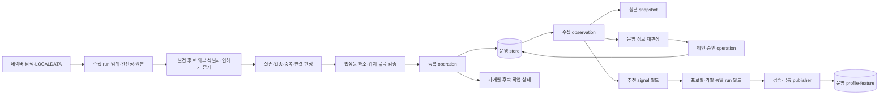

# 데이터 최신화 v3 — 안정화·운영화 스펙

> 작성: 2026-09-25 · 상태: v3 목표 스펙, FR-02/08 부분 구현·미배포
> 구현 순서: [v3 plan](./data-freshness-v3-plan.md)
> 이번 종류 근거 변경의 전환 게이트: [kind evidence rollout](./kind-evidence-rollout.md)
> 이전 기준: [초기 spec](./data-freshness-spec.md) · [설계서 v2](./data-freshness-design.md) · [아키텍처 개요](./architecture-overview.md)

## 1. 목적과 문서의 적용 범위

수집·가게 등록·추천 데이터 반영이 서로 다른 시점에 성공하거나 실패해도, 무엇이 완료됐고 무엇을 다시 처리해야 하는지 남는 최신화 시스템을 만든다. 이미 수집한 증거를 재사용하고, 잘못된 반영과 반복 탐색을 줄이는 것이 우선이다.

이 문서는 2026-09-25 로컬 코드 검토와 첨부된 「빵끗 데이터 최신화 구조 — 현황·고민·개선안」을 배경으로 작성했다. 첨부 문서의 제안은 검토 입력이며, 실제 구현 여부는 코드로 구분했다. 운영 DB를 조회해 수치나 데이터 품질을 재검증하지는 않았다.

이하 MUST는 v3 구현의 필수 수용 조건, SHOULD는 기본 권고다. 현재 구현이 이미 충족한다는 뜻이 아니다. v3 범위의 충돌하는 요구사항은 이 문서를 적용하고, 이전 문서는 초기 도입 기록으로 보존한다. 특히 초기 plan의 도메인 삭제·DB 볼륨 초기화 절차는 v3 이관 절차가 아니다.

이번 구현 범위는 FR-02/08의 종류 근거 수명이다. 메뉴 관측 원장, legacy 소멸 근거 보존, 공통 분류/상태 판정, profile/feature의 같은 근거 확인을 다룬다. FR-01의 전체 observation·attempt/lease·작업 예약 모델, FR-08의 전체 publisher, BE 소비자·캐시·회원 재계산까지 구현됐다는 뜻이 아니다. 일회용 격리 DB에서 migration/최소 publisher 테스트만 수행했으며 대상 환경 migration 적용·운영 수집/배치·publish는 실행하지 않았다. P2/P5 및 전체 v3 완료 게이트는 유지한다.

### 1.1 유지하는 선택

- dataops와 서비스 BE 레포를 분리한다. 운영 스키마 소유자는 BE다.
- 원본 → 파싱·판정 → 검수 → 운영 반영의 책임을 분리한다.
- PostgreSQL 상태 테이블과 `next_due_at`을 작업 목록으로 사용한다.
- Python은 수집·분석·특성 계산을, Java는 상태 전이·승인·원천 정보 반영을 담당한다.
- 제안 기본 모드는 `PROPOSAL_ONLY`다. 자동 승인 확대는 별도 단계 게이트를 통과한 필드에만 적용한다.

### 1.2 포함·제외

| 포함 | 이번 단계에서 제외 |
|---|---|
| 변경 감지 누락, 승인·재판정·등록 복구의 정합성 수정 | Kafka/Airflow 등 신규 플랫폼 도입 |
| 발견 후보 영속화, 인허가 연결의 선택적 모델링 | 전국 격자 전수 탐색 및 검색어 무제한 확대 |
| 신호·프로필·라벨의 실행 이력과 일관된 반영 | 추천 점수 산식·취향 사전의 전면 개편 |
| 반복 실행, 지연 감지, 원격 백업·복원 | 폐업 자동 확정, G1 대상 업종의 임의 확대 |
| 공공데이터 수집 범위·완전성·재개·기준선 갱신 | 수집 범위 확대를 서비스 업종 확대와 동일시하는 것 |
| 법정동 기준 지역 분류와 주소 변경 시 동기화 | 행정동을 법정동 컬럼에 대체 저장하는 것 |
| 기존 파일·테이블의 비파괴 이관 | 운영 `public` 스키마를 dataops가 직접 변경하는 작업 |

### 1.3 영역별 요구사항 위치

| 영역 | 요구사항 | 구현 단계 |
|---|---|---|
| 데이터 최신화·소멸 확인 | FR-01~04, FR-07 | P1~P3 |
| 공공데이터 원천 수집·월간 diff | FR-10 | P4-0, P6 |
| 네이버 역매핑·탐색 후보 | FR-05/06, FR-10의 탐색 완전성 | P4, P7 |
| 추천을 위한 신호·라벨 | FR-02/08 | P2, P5 |
| 가게 프로필·추천 소비자 | FR-07/08 | P5 |
| 법정동 `region_1st/2nd/3rd` | FR-11 | P1의 보류 안전장치, P4-4 |
| 지속 가능한 실행 환경·감시 | FR-09/10 | P0, P6 |

## 2. 확인된 문제와 설계 결정

| ID | 코드로 확인한 현재 동작 | v3 결정 |
|---|---|---|
| F-01 | `ParsedPlace`·주소 판정은 주소/좌표를 사용하지만 hash에는 없고, 같은 hash면 원본 저장을 생략. 추천 신호도 hash에서 누락 | 판정 입력과 hash 계약을 맞추고 운영/추천 변경 감지와 관측 기록을 분리 |
| F-02 | 승인에서 운영 DML 후 `PENDING` 검사, 일부 UPDATE는 ID 조건만 사용 | 쓰기 전 상태 점유·제안 최신성·예상 이전 값 검증 |
| F-03 | 전체 재판정은 모든 PENDING을 지운 뒤 NAVER 스냅샷만 재생 | 생성 경로별 범위와 세대를 지정하고 성공한 범위만 교체 |
| F-04 | 역탐색 주소 키가 행정구역·건물 부번을 버림 | 지역·완전한 건물번호·거리·모호성을 함께 판정 |
| F-05 | 후보가 `mgmt_no NOT NULL UNIQUE`, 성공 매칭만 DB 적재 | 발견 식별자와 인허가 증거를 분리하고 실패·보류 후보도 저장 |
| F-06 | 등록 중 운영 INSERT 뒤 실패하면 재시도에서 후속 상태 복구를 건너뜀 | 신규·기존 귀속 모두 같은 후속 상태 보완 절차로 수렴 |
| F-07 | 프로필·라벨 별도 커밋, 근거 없는 라벨은 산출물에서만 제외 | 불변 실행 산출물·공통 publisher·명시적 무효화 집합 |
| F-08 | 수집과 신호 rebuild·추천 적재의 연결이 수동 | 단계별 작업 상태, 재시도, 완료·지연 지표 제공 |
| F-09 | 일반음식점 일반 수집은 미커밋 변경에서 full이지만 월간 `run_delta()`는 keyword 고정. diff의 기준선 치환에는 범위·완료도 검증이 없음 | 최초/정기 수집 정책 통합, 좁거나 미완료인 pull로 전량 기준선 대체 금지 |
| F-10 | Reconcile 주소 제안에는 region이 없고 승인은 region을 받은 경우만 갱신. 별도 지역 보정은 존재하지만 BE의 H 기반 writer/소비 경로도 남음 | 법정동 기준 공통 resolver와 위치 묶음 반영, 기존 H 경로 및 소비자 호환 이관 |
| F-11 | 재개 스크립트가 `/private/tmp`의 venv를 참조하고 로그에 모듈 로딩 실패가 기록됨. 자식 프로세스 실패도 마지막 echo에 가려질 수 있음 | 영속 실행 환경·기능 preflight·실패 전파. 임시폴더 정리가 원인이었다는 설명은 사용자 보고와 구분 |
| F-12 | 미커밋 `--deep`은 페이지 탐색을 추가하지만 완료 키는 region/query뿐이고 중간 페이지 실패와 완주를 구분하지 않음 | 탐색 모드/정책/페이지 범위별 재개·완료 계약을 먼저 고정 |

판단에 사용하지 않을 가정:

- `KAKAO_IMPORTED`라는 이유만으로 인허가 미연결로 집계하지 않는다. `localdata_status_delta.py`는 기존 매핑 TSV와 등록 후보표를 모두 읽는다. 로컬 TSV의 AUTO 34,819행은 과거 매핑 산출물이지 현재 운영의 유효 연결 수가 아니다.
- 인허가 매칭 실패는 실제 인허가 부재를 증명하지 않는다. 전화번호 불일치도 같은 한계를 가진다.
- 신규 추천 후보의 필수 join은 `store_profile`이다. `store_recommendation_feature`는 현재 BE에서 LEFT JOIN하므로 라벨 부재와 프로필 부재를 구분한다.
- 문서의 누적 등록 수와 회차별 탐색 깔때기를 같은 모집단으로 합산하지 않는다. v3 지표에는 실행 ID와 대상 범위를 붙인다.
- “키 2개로 하루 19,000콜”은 확인할 운영 예산 가정이다. 현재 `DAILY_CALL_BUDGET=9500`은 모드 선택 임계값이며 실제 키별 사용량 제한 구현이 아니다. 재시도·메타 조회도 호출량이다.
- 지번 앞 3토큰은 기존 등록 관행이지 전국 공통 법정동 해석 규칙이 아니다. `commonAddress`의 이름만으로 B(법정동)/H(행정동)를 구분하지 않는다. 운영 전체가 이미 법정동으로 통일됐다고 가정하지 않는다.

## 3. 목표 흐름과 소유권

운영 쓰기는 두 종류로 구분한다.

| 데이터 | 허용 쓰기 경로 | 감사·복구 단위 |
|---|---|---|
| 가게·메뉴·매칭·영업시간 등 원천 정보 | Java `ServingWriter`와 이를 호출하는 operation 서비스 | operation + before/after + proposal·근거 참조 |
| 재계산 가능한 `store_profile`, `store_recommendation_feature` | Python 공통 `ProjectionPublisher` — 신규 구성요소 | run manifest + 대상별 before/after + publish 결과 |

기존 원천 정보 직접 UPDATE 스크립트는 승인/operation API로 전환한다. 특성 적재까지 Java로 옮기는 것은 요구하지 않는다. 두 경로 모두 실행 의도와 결과를 남기며, 이행 후 문서의 “단일 통로”는 각 데이터 종류의 지정 writer를 의미한다.

이 지정 writer 계약은 dataops와 연동 자동화 배치에 적용한다. BE의 정당한 사용자 기여 쓰기를 없앤다는 뜻이 아니며, 그 경로와의 경쟁은 현재값 검증·보호 조건으로 처리한다.

## 4. 기능 요구사항

### FR-01 관측·원본·변경 감지

1. 성공한 새 방문은 `observation_id`, `attempt_id`, 가게·소스·외부 ID, `fetched_at`, `received_at`, 파서/해시 버전, 영역별 파싱 완전성, 두 의미 해시, 근거 snapshot을 MUST 남긴다. 같은 요청의 네트워크 재전송은 같은 ID를 재사용한다.
2. 같은 요청 ID·같은 내용은 기존 결과를 반환하고 방문·소멸 카운터를 다시 증가시키지 않는다. 같은 ID·다른 내용은 충돌이다. 새 방문의 동일 내용은 별도 관측이다.
3. `store_hash`는 실제 운영 정보 판정 입력 전체를 포함한다. 최소한 기존 필드에 주소·도로명주소·위경도를 추가한다. `signal_hash`는 리뷰 수·별점·투표 키워드·리뷰 메뉴·대표 메뉴·카테고리·편의정보 등 signal parser가 소비하는 의미 필드 전체를 포함한다.
4. 해당 영역 해시 또는 파서/해시 버전이 바뀌면 필요한 원본을 MUST 보존한다. 운영 정보만 바뀌면 재판정, 추천 신호만 바뀌면 signal 빌드를 예약한다. 원본 저장·작업 상태 예약은 같은 로컬 트랜잭션에 속한다.
5. 두 해시가 같으면 기존 근거 snapshot을 참조할 수 있다. 임의의 무시 필드까지 최신 원본에 보존된다는 보장은 하지 않는다. 향후 파서가 새 필드를 사용하면 원본 가용성을 검사하고 필요 가게를 재수집한다.
6. 차단·타임아웃·파싱 불완전·명시적 페이지 부재를 구분한다. 불완전 영역은 기존 값을 지우거나 “메뉴 없음”, “폐업”으로 해석하지 않는다. 페이지 부재도 폐업 확정이 아닌 검토 신호다.
7. 늦게 도착한 이전 attempt는 최신 상태·제안·신호를 되돌리지 않는다. attempt 세대와 외부 ID를 검증하며, worker 시계만으로 순서를 결정하지 않는다. 시각 API는 offset을 포함하고 기존 DB의 KST TIMESTAMP와 명시적으로 변환한다.
8. 수집 성공과 파생 처리 성공은 분리한다. 판정/신호 빌드 실패 후에도 원본과 실패 작업을 보존하고, 재크롤 없이 재처리한다. 최신 관측이 정책상 무변경이어도 미완료 작업은 남는다.
9. 모든 수용된 관측은 완전성·소멸 확인·신선도 확인을 멱등하게 처리한다. 해시는 무거운 재파싱·의미 diff 생략에 사용하며 이 확인 절차를 생략하지 않는다. 같은 해시의 두 번째 관측으로 소멸 기준을 통과하거나 근거 확인 시각이 전진하면 필요한 파생 단계도 다시 예약한다.

**관측 시각 계약**

| 값 | 의미 |
|---|---|
| `last_success_at` | 수집 프로토콜에서 정의한 성공한 방문의 시각. 영역별 완전성을 대체하지 않음 |
| `signal_observed_at` | 현재 사용하는 signal과 같은 의미 해시를 마지막으로 완전하게 확인한 시각 |
| `computed_at` | 해당 버전의 계산 완료 시각 |
| `published_at` | 대상 운영 DB 반영이 확인된 시각 |

추천 feature의 `observed_at`은 실제 사용한 메뉴·리뷰 증거의 확인 시각으로 계산한다. BOTH이면 두 근거의 보수적인 시각(최솟값)을 사용하고, 확인할 수 없으면 NULL/UNKNOWN으로 남긴다. 단순 `max(last_success_at)`이나 빌드 시각으로 신선도를 만들지 않는다.

### FR-02 메뉴 소멸 확인

- “종류·축은 연속 2회, 대표 메뉴는 1회”라는 기존 정책은 유지하되, 횟수는 변경 snapshot 수가 아니라 서로 다른 완전한 관측으로 센다.
- 메뉴별 `first_missing_at`, `consecutive_missing_count`, `last_evaluated_observation_id` 또는 동등한 증거를 유지한다. 다시 나타나면 연속 횟수를 초기화한다.
- 재전송·부분 파싱·실패는 확인 횟수에 넣지 않는다. 실패 관측은 연속성 판단을 보류하고, 정책상 허용하는 최대 관측 간격을 넘으면 연속 횟수를 다시 시작한다.
- 최소 독립 관측 간격과 최대 간격은 버전이 있는 정책 설정으로 고정한다. 같은 세션의 즉시 재시도 두 번을 독립 확인으로 인정하지 않는다. 이번 구현의 제안 기본값은 최소 6시간·최대 30일이며 확정된 운영 임계값이 아니다. 설정값과 정책 버전을 fingerprint에 포함하고, 배포 전 기존 티어 주기·제한된 표본에서 확인 지연/오탐을 검증한 뒤 적용한다.
- 파생 특성에서 제외하는 것과 운영 메뉴 soft delete 승인은 별도 결정이다.

**소멸 근거의 수명 (2026-09-25 추가)**

- 소멸 근거는 **제안의 승인 상태와 독립적으로** 유지한다. 변경 전 `vanished_menu_ids()`는 `PENDING`만 읽고, 승인된 메뉴는 운영의 `deleted_at IS NULL` 조회에서도 빠진다. 이 조합에는 같은 과거 리뷰의 종류를 다음 배치에서 다시 허용할 수 있는 경로가 있다. 사용자 제공 09-25 조사 수치인 승인 제안 5,650건·가게 1,091곳·종류가 붙은 제안 5,613건은 **승인/분류 현황이며 실제 부활 재현 건수가 아니다**. 이 문서 작성 과정에서 운영 DB로 그 수치나 부활 건수를 재검증하지 않았다.
- **“운영 메뉴에 같은 종류가 0개”만으로 현재 판매 부재를 확정하지 않는다.** 그것은 근거의 한 조각이고, 산출물·로그에 “판매 종료”로 기록하지 않는다(FR-01의 관측 시각 계약과 같은 이유).
- **검증된 현재 근거의 명시적 재등장만 소멸을 되돌린다.** 가게가 `밤식빵`을 다시 시작해 **메뉴판 또는 대표 메뉴**에 나타나면 재평가하고 되살린다. 다만 **과거 리뷰 집계가 다시 수집된 것만으로는 복원하지 않는다** — 수집 시각이 최신이어도 리뷰 내용은 과거이고, 같은 메뉴를 말하는지도 알 수 없다. 시점·대상 동일성을 판단할 수 없으면 UNKNOWN/CONFLICT 로 남기고 자동 복원하지 않는다.
- **종류 판정의 별칭 정규화를 통일한다.** 변경 전 리뷰 경로(`kind_of_label` — `menu_kind_axis` 끝말 일치)와 대표 메뉴 경로(`menu_classifier.classify`)는 다른 분류기다. 순수 함수 확인(09-25): `찹쌀꽈배기`·`초코크로와상`은 리뷰 경로에서 None, 대표 경로에서 각각 `도넛`·`크루아상`이다. 사용자 제공 09-25 조사에서 두 목록의 차이는 375건으로 보고됐으며, 분류기 차이와 낡은 근거가 각각 차지하는 비율은 미확인이다. **교집합으로 자르거나 합집합으로 맞추면 원인을 숨긴다.** 분류를 통일한 뒤에야 `signature_kinds ⊆ 유효 종류 집합`을 목표로 삼을 수 있다.

**이번 부분 구현의 원장·legacy 전환 계약**

- `menu_evidence_observation`은 메뉴/종류 판정용 불변 원장이다. 수용한 새 수집은 기존 content hash가 같아도 원장에 남긴다. 이번 API의 요청 식별자는 `observationId`이며 같은 ID의 재전송은 한 관측이다. 다른 내용/외부 ID/관측 메타데이터의 재사용은 충돌로 처리한다. 새로운 방문의 동일 내용은 새 ID를 사용한다.
- 외부 ID, offset을 포함한 관측 시각, 메뉴 영역 완전성 등 검증 메타데이터가 확인된 관측만 독립 확인에 사용한다. 구 worker의 메타데이터 누락, 불완전 관측, 늦거나 외부 ID가 맞지 않는 입력을 정상 음성 관측으로 간주하지 않는다. 원장 추가만으로 FR-01 전체 lease/attempt 계약을 충족한 것으로 표시하지 않는다.
- 현재 저장된 실제 메뉴 fixture는 target identity와 양성 메뉴는 확인되지만 목록 전체 수(`total`/`totalCount`)가 없어 `menu_complete=false`다. 자동 소멸 확인을 진행할 수 있는 운영 payload 완전성이 확보됐다고 가정하지 않는다. 파서 조건을 완화하거나 합성 total로 채우는 대신 완전성을 확인할 수 있는 수집 계약을 별도 검증한다.
- 기존 NAVER 메뉴 소멸 제안(PENDING/APPLYING/APPROVED)의 근거는 `menu_evidence_legacy_removal` 사본에 출처와 함께 보존하고 제안 FK·현재 승인 상태의 수명에 종속시키지 않는다. migration의 대상 조건에 맞는 원천 소멸 제안과 다른 사유의 제외 제안을 구분한다. legacy 제안 수·snapshot 수·승인 시각으로 독립 관측 횟수나 현재 판매 부재를 만들어내지 않는다.
- 검증 관측이 없는 legacy 소멸 근거는 UNKNOWN 보류다. **근거 보존과 운영 제외 승인은 다르다.** 이름/종류의 미해결 legacy hold 또는 이름을 식별할 수 없는 legacy 행이 남은 가게는 `NEEDS_REVIEW`로 기록하고, 선택 범위의 profile/feature publish를 전부 차단해 기존 serving 결과를 유지한다. shadow에서 제외한 결과를 실제 판매 종료나 `WITHOUT_LABELS`로 게시하지 않는다. 무효화 승인 플래그로 이 보류를 우회할 수 없다.
- legacy 기준 시각은 정확한 proposal·snapshot의 store/source/target을 검증한 `place_snapshot.fetched_at`이다. `created_at`은 처리 시각으로 별도 보존할 뿐 관측 시각 대체값으로 쓰지 않는다. 누락·불일치는 NULL/UNKNOWN으로 남기며 양성뿐 아니라 과거 음성 두 건의 재생으로도 자동 해제하지 않는다. 기존 Flyway 파일은 유지하고 후속 교정 migration으로 provenance를 남긴다.
- 시각/이름이 확인된 legacy는 그 이후의 검증된 직접 양성 또는 정책에 맞는 독립·완전 음성 두 번으로 재평가한다. 같은 종류의 새 이름이 나타나도 옛 이름 hold가 남으면 가게의 publish는 계속 보류된다. snapshot 두 행이나 제안 수로 독립 관측을 추정하지 않는다. 보류 사유와 shadow 결과 변화, 실제 게시 후보의 변화를 분리해 보고한다.

### FR-03 승인·운영 반영 operation

**승인 전 조건**

1. 외부 쓰기 전에 제안이 승인 가능하고 최신 근거에도 유효한지 MUST 확인한다. 검증 후 `PENDING → APPLYING` 점유와 operation 생성이 로컬 DB에 확정돼야 한다. 로컬 트랜잭션 종료 시점의 낙관적 잠금만으로 보호했다고 간주하지 않는다.
2. REJECTED/SUPERSEDED/EXPIRED/CONFLICT 승인 요청은 운영 DML 0회다. 같은 승인 요청 재시도는 기존 operation 결과를 반환한다. 같은 idempotency key에 다른 요청 내용은 충돌이다. APPLYING은 새로 실행하지 않고 진행 상태를 반환한다.
3. 운영 쓰기는 예상 이전 값·활성 상태·사용자 기여 보호 조건을 WHERE 조건 또는 잠금 안에서 검사한다. 영향 행 수 0을 성공으로 처리하지 않는다. 주소·좌표·지역, alias·개명처럼 한 의미 변경에 속하는 SQL은 같은 운영 트랜잭션에 묶는다.
4. 운영 값 A→B 제안 뒤 운영이 C로 바뀌면 CONFLICT다. 운영은 A 그대로지만 새 원천 관측이 B에서 A로 돌아왔다면 제안은 EXPIRED다. 값 비교와 근거 최신성 검증은 둘 다 필요하다.
5. 재판정·승인·등록은 같은 가게/target의 경쟁 작업을 직렬화한다. APPLYING인 제안을 재판정이 삭제·대체하지 않는다. 새 근거는 후속 재판정 대상으로 기록한다.

**감사와 두 DB 사이 실패**

- `apply_operation`을 의도·결과의 정본으로 추가한다. `operation_id`(unique), 종류, 자연키/대상, 요청 fingerprint, 예상 이전 값, 제안/후보/실행 참조, 상태, 시각, 오류를 저장한다. INSERT 이전에도 candidate/placeId로 선기록할 수 있어야 한다.
- 상태는 `PREPARED → APPLYING → APPLIED | FAILED | UNKNOWN | CONFLICT`다. 복구 대사로 현재 목적 값만 확인됐을 때는 별도 `RECONCILED_MATCH`로 기록하며 원래 작업의 성공을 증명했다고 표현하지 않는다.
- `apply_log`는 변경 상세 이력으로 유지하고 operation에 연결한다. 실제 before-image를 사용하며 실패 로그를 지우지 않는다. 과거 선기록 로그를 일괄 APPLIED로 추정하지 않는다.
- 운영 커밋 응답 유실 또는 운영 성공 뒤 로컬 기록 실패는 UNKNOWN이 될 수 있다. UNKNOWN은 곧바로 재실행하지 않고 대사한다. 현재값이 같다는 이유만으로 생성 provenance나 당시 커밋 성공을 만들어내지 않는다.
- 로컬 DB와 운영 DB 사이 원자적 커밋·정확히 한 번 실행을 보장한다고 주장하지 않는다. 단일 운영 트랜잭션, 고유키, 조건부 쓰기, operation 점유와 대사로 위험을 제한한다.
- 보상 변경은 새 operation으로 수행하며, 현재 값이 복구 대상 before/after와 호환되는지 확인한다. 이후 정당한 사용자 수정을 덮는 자동 역적용은 금지한다.

### FR-04 범위가 있는 재판정

- 모든 제안은 `producer`(SNAPSHOT_RECONCILE, LOCALDATA_CLOSURE, NAVER_MATCH, CATEGORY_BATCH 등), 근거 observation/snapshot, `policy_version`, `reconcile_run_id`를 SHOULD 가진다. 기존 불명 제안은 `LEGACY_UNKNOWN`으로 보존한다.
- 재판정 범위는 producer + store + target family다. `source=NAVER`만으로 매칭·분류·스냅샷 판정을 묶지 않는다.
- 한 가게·범위의 전체 판정이 성공한 후, 같은 로컬 트랜잭션에서 신규 제안과 기존 세대의 SUPERSEDED/EXPIRED를 확정한다. 전체 PENDING DELETE는 금지한다.
- 부분 파싱·개별 실패·중단 시 기존 유효 제안을 유지한다. APPLYING/APPROVED/다른 producer/LEGACY_UNKNOWN은 자동 교체 대상이 아니다.
- 같은 store×target에는 실행 가능한 제안을 하나만 둔다. 다른 producer가 경쟁하면 기존 제안을 삭제하지 않고 충돌 근거를 기록해 재검토한다.
- 거절한 동일 근거·동일 정책의 제안은 재상정하지 않는다. 새 증거나 정책 변경으로 재상정할 때는 이전 거절 사유를 연결한다. 기존 문자열 값만으로 영구 차단하지 않는다.

### FR-05 발견 후보와 인허가 관계

**식별 모델**

- `new_store_candidate.id`를 내부 후보 키로 유지·확장한다. 네이버 역탐색은 `(NAVER, placeId)`로 발견 즉시 upsert한다. 인허가 미매칭·시설 오탐·기존 가게 의심·정책 제외도 처리 이력을 남긴다.
- `candidate_external_ref`는 장소를 식별하는 외부 ID를 저장한다. `(source, external_id)`는 유일하고, 서로 다른 외부 ID의 후보 병합은 증거를 남기는 명시적 작업이다.
- `candidate_license_link`는 인허가 레코드와 후보의 관계·상태·근거·검증 시각을 저장한다. 키는 source/dataset/관할 식별자/관리번호의 원천 유일성 계약에 따른다. 인허가를 장소 ID와 동일시하지 않는다.
- `mgmt_no`는 이관 중 legacy 필드로 유지하고 nullable로 바꾼다. 등록 API의 기본 키는 candidateId로 옮긴다. 인허가 여러 개가 한 장소에 붙거나 시설 인허가 하나가 여러 장소 후보에 나타나는 상황을 표현하되, 다중 연결을 자동 확정하지 않는다.
- `store.source`는 유입 출처다. 인허가 연결 여부를 표현하기 위해 enum 값을 추가하는 것은 v3 기본안이 아니다. 나중에 인허가를 연결해도 최초 유입 출처는 바뀌지 않는다.

**독립적인 판정 축**

| 축 | 값 예시 | 결정하는 것 |
|---|---|---|
| `eligibility_status` | UNKNOWN / ELIGIBLE / INELIGIBLE / REVIEW | 서비스가 다루는 업종·실존 근거 |
| `duplicate_status` | UNCHECKED / DISTINCT / LINKED_EXISTING / AMBIGUOUS | 기존 가게 귀속 또는 신규 등록 가능성 |
| `license_match_status` | UNRESOLVED / MATCHED / AMBIGUOUS / REJECTED_LINK | 인허가 증거 연결 상태 |
| `registration_status` | NOT_REGISTERED / APPLYING / REGISTERED / RECOVERY_REQUIRED | 운영 가게 귀속·등록 및 로컬 후속 상태 |

후보에는 첫/마지막 발견 시각, 마지막 시도, 다음 검토일, 규칙 버전, 판정 사유, 근거 위치를 저장한다. 최신 근거는 파일명·입력 순서가 아닌 유효한 관측 순서로 선택하며, 순서를 알 수 없으면 모호함을 남긴다. `NOT_FOUND` 하나에 네이버 검색 부재와 인허가 미연결을 섞지 않는다. 제외 후보의 tombstone을 유지해 매번 새 후보로 재발견하지 않는다.

미연결 후보 보관은 필수다. 미연결 운영 등록은 `allow_unlinked_license_registration=false`를 기본으로 두고 D-01 정책에 따라 활성화한다. 활성화해도 실존·업종·중복 판정은 모두 통과해야 한다. 불명 카테고리·메뉴 없음은 자동 PASS가 아닌 UNKNOWN/REVIEW다. 플래그를 다시 OFF로 바꿔도 이미 등록된 가게를 자동 삭제하지 않는다.

### FR-06 주소·전화 기반 동일 장소 판정

- 주소 키는 시도/시군구의 정규화된 코드 또는 명칭, 도로명, 건물 본번·부번을 보존한다. 지역 정보가 불완전하면 전국 이름 매칭으로 자동 확정하지 않는다.
- 좌표가 있으면 좌표계·정확도·거리 상한을 검사한다. 거리 상한은 정책 버전에 속한다. 좌표가 없거나 후보가 여러 개면 이름 유사도 임계값 하나로 확정하지 않는다.
- 전화번호는 국가/지역번호 정규화, 공유번호 여부, 원천과 관측 시각을 저장한다. 일치 여부는 보조 증거이며 대표번호·양도·재사용 가능성을 고려한다.
- 수집 계약은 placeId·이름·카테고리·주소·좌표·전화(원천 제공 시)·관측 시각을 보존한다. 제공하지 않는 필드는 UNKNOWN으로 둔다.
- 대조용 주소 키와 운영 `region_*` 저장 규약은 구분한다. 지역 저장·변경은 FR-11의 공통 resolver를 사용하며, 인허가 미매칭의 해석에는 FR-10의 원천 수집 범위·완료도를 전달한다.
- 매칭 결과에는 사용한 신호·후보 수·선택 사유·규칙 버전을 저장한다. 주소 매칭과 기존 가게 중복 판정은 같은 정규화 계약을 사용한다.
- 연결된 인허가의 폐업 신호도 장소 연결의 유효성과 독립적인 최근 생존 증거를 재검토한다. 영업 승계로 종료된 과거 인허가의 폐업을 현재 영업체 폐업으로 간주하지 않는다. 수집 장애를 네이버 부재로 취급하지 않는다.

### FR-07 등록과 후속 작업 복구

등록은 다음 조건을 모두 만족해야 REGISTERED다.

1. candidate/placeId에 대한 operation과 운영 store 귀속이 확인됨.
2. 필요한 sync_state가 존재하고 externalId가 일치함.
3. 출처·귀속 증거가 기록됨. 원래 있던 가게를 이번 실행이 생성했다고 표시하지 않음.
4. 초기 observation 또는 초기 수집 작업이 내구성 있게 저장됨.

신규 INSERT, 기존 ACTIVE 귀속, 재활성은 모두 같은 `ensureRegistrationCompleted` 성격의 복구 절차를 통과한다. 각 단계는 멱등이어야 한다. store ID만 존재하고 나머지가 미완료면 RECOVERY_REQUIRED이며 다음 실행이 후속 작업부터 이어간다. DELETED 가게 재활성은 단순 placeId 발견만으로 승인하지 않고 이전 제외·폐업 사유를 재검토한다.

REGISTERED와 추천 준비 완료는 구분한다. 후속 `pipeline_item`은 OBSERVATION_PENDING / SIGNAL_PENDING / BUILD_PENDING / PUBLISH_PENDING / COMPLETE / RETRY / BLOCKED 상태를 가진다. COMPLETE는 해당 작업 버전·관측에 대한 파이프라인 완료이며, 추천 쿼리의 지역·빵집다움 필터까지 통과한다는 뜻은 아니다.

### FR-08 신호·프로필·라벨 빌드와 반영

**입력·실행 계약**

- `pipeline_run`의 manifest에 `run_id`, 대상 환경·store 집합, 기준 시각, 가게별 observation/snapshot/signal 해시, 운영 메뉴·분류·좋아요 추출물 fingerprint, 파서·분류기·사전·계산 버전과 실제 내용 hash, 코드 revision, 변경된 코드가 있다면 별도 digest를 기록한다.
- 프로필과 라벨은 같은 고정 입력 묶음으로 계산한다. 운영 메뉴는 제한된 읽기 전용 일관성 구간에서 한 번 추출해 산출물과 함께 보관한다. 두 DB의 동일 순간 snapshot을 보장하는 것으로 표현하지 않는다.
- 전역 태그 기준 모집단·사전 비율(prior)·분포/정규화 파라미터도 고정 입력이다. 현재 `vote_scale()`이 참고하는 전체 signal과 직전 draft의 빵집다움은 승인된 기준 run/추출물로 고정하고 checksum을 남긴다. 빌드 도중 최신 draft를 다시 읽지 않는다.
- NAVER hash 이외의 입력 변경도 빌드 사유다. 운영 메뉴·분류·좋아요·정책/사전/기준 분포 변경은 제한된 주기 입력 fingerprint 비교 또는 확인된 변경 통지로 감지한다. 무변경 관측의 소멸 임계값 통과와 관측 시각 전진도 예약하되, 여러 변경은 최신 입력 기준으로 병합할 수 있다.
- 검수용 draft는 `(run_id, store_id)` 단위로 격리한다. 새 실행이 이전 검수표를 TRUNCATE하거나 수정하지 않는다. 검증이 끝난 산출물·manifest는 불변이다.
- 대상별 결과는 WITH_LABELS / WITHOUT_LABELS / INELIGIBLE / FAILED / NOT_PROCESSED를 구분한다. WITHOUT_LABELS는 완전한 입력을 처리했으나 근거 기준 미달인 경우다. 읽기 실패를 근거 소멸로 분류하지 않는다.
- INELIGIBLE은 승인된 서비스 제외 정책 또는 운영에서 확정된 폐업/제외 상태에 해당하는 경우다. 빵집다움 하한 미달·특정 상권 밖·사용자별 후보 필터 탈락만으로 이 상태를 만들거나 프로필을 삭제하지 않는다.
- 필수 영역의 입력이나 signal 버전이 불일치하면 빌드를 보류한다. 이전 signal을 쓸 경우 명시적인 stale 결과이며 최신 성공으로 표시하지 않는다.

**반영 계약**

1. 공통 publisher가 프로필 upsert·라벨 upsert·명시적 무효화를 하나의 대상 운영 DB 트랜잭션으로 수행한다. SQL을 청크로 전송할 수 있지만 중간 commit은 하지 않는다. 범위를 줄일 때는 별도 manifest/run을 만든다.
2. 같은 대상 DB의 publish는 직렬화한다. 이전 run이 새 run의 값을 덮지 않도록 실행 순서와 대상별 기존 fingerprint를 확인한다.
3. 선택 범위에 FAILED/NOT_PROCESSED가 있으면 기본적으로 반영을 막는다. 성공 부분만 반영하려면 그 집합을 범위로 하는 새 검증 manifest를 만든다. 입력 전체와 운영 전체의 단순 차집합으로 삭제하지 않는다.
4. WITHOUT_LABELS인 가게는 해당 feature 행을 명시적으로 삭제해 기존 라벨을 무효화한다. 현재 운영 스키마는 9개 라벨이 NOT NULL이며 label_source도 NONE을 허용하지 않아 NULL/0으로 부재를 표현하지 않는다.
5. 위 삭제는 재계산 가능한 파생 행의 제한된 예외다. 검증된 run의 명시적 ID 집합·before-image·감사를 요구한다. 원천 store/menu와 감사 이력의 물리 삭제 금지는 유지한다. INELIGIBLE로 확인된 가게의 파생 두 표 제거도 같은 계약에 따른다.
6. 반영 직전 대상 DB 식별·스키마·권한·store 귀속/상태를 확인한다. FK 불일치·예상하지 못한 신규 탈락은 집계하고 반영을 중단한다. 다른 환경의 사본은 그 환경에 맞춘 별도 manifest를 검증한다.
7. 운영 commit 후 로컬 성공 기록이 실패하면 publish UNKNOWN으로 남긴다. 읽기 대사로 두 표의 대상별 결과를 확인한다. 새 publish가 실행됐거나 값이 달라졌으면 오래된 산출물을 자동 재적재하지 않는다.
8. 기존 `batch_version`은 계산 버전으로 유지한다. run ID를 그 필드에 임의로 혼용하지 않는다. 실행 이력은 로컬 manifest에 두므로 최초 구현에 운영 DDL은 요구하지 않는다.

현재 BE의 프로필 inner join·라벨 left join을 기준으로 프로필 coverage, 라벨 coverage, 실제 추천 적격 coverage를 따로 검증한다. 라벨 삭제 시 점수 fallback과 전체 라벨 평균 소비 경로도 검증한다. `LabelCenterParams`의 평균 캐시는 현재 TTL 30분이다. v3 기본안은 이 지연을 수용하며 두 표의 원자적 반영이 모든 추천 계산의 즉시 세대 일치까지 보장하지는 않는다. 회원 취향 집계의 재계산 주기는 별도로 확인하고, 즉시 일치가 필요하면 BE 캐시/집계 무효화 계약을 후속 작업으로 분리한다.

**종류 근거의 소비 계약 (2026-09-25 추가)**

종류 근거는 한 곳에서 판정하고 **소비자가 쓸 것을 고른다.** 지금은 같은 리뷰 루프가 세 출력으로 갈라지는데 필터가 한 곳에만 걸려 있다.

| 출력 | 현재 입력 | 소비처 |
|---|---|---|
| `kinds` | `menu_kinds_all` ∪ `rv_kinds` | LLM 이유 프롬프트의 **기준 목록**(`ReasonPromptBuilder`) · 추천 점수의 종류 겹침 항 |
| `signature_kinds` | 대표 메뉴 이름을 `classify` | “{종류} 취향” 배지 · 규칙형 추천 문장(`ReasonEvidenceResolver`) · 회원 추정 취향(`UserTasteSignalJdbcRepository`) · 프롬프트 **정렬 순서** |
| 4축·타입 | `rv` (같은 루프의 다른 수집) | 추천 점수 |
| 취향 라벨 9개 | `recommendation_feature_load`의 별도 리뷰 입력 | 추천 점수 |
| 빵집다움 | 카테고리 · **종류 목록(병합 `kinds` 가 아니라 `menu_kinds_all`)** · 투표 신호 | 후보 자격 |

- **공통 상태를 공유하고 임계값은 소비자가 고른다.** 종류별 상태를 `PRESENT / MISSING_ONCE / CONFIRMED_MISSING / UNKNOWN` 로 한 곳에서 판정하고, 각 출력이 어느 상태부터 뺄지를 정책으로 정한다 — 대표 메뉴는 `MISSING_ONCE` 부터, 종류·축은 `CONFIRMED_MISSING` 부터다(기존 "대표 1회 · 종류 2회"가 이 형태다). **출력이 서로 다른 것 자체는 결함이 아니고, 그 차이가 명시된 정책으로 설명되지 않는 것이 결함이다.**
- **필터를 각 출력에 복사하지 않는다.** 공통 근거(종류별 유효성·소멸 상태·최신 관측)를 먼저 판정하고, 각 소비자가 그중 무엇을 쓸지 계약으로 정한다. 한 출력에만 필터를 걸면 **목록에서는 사라졌는데 추천 성향에는 남는** 상태가 된다.
- **독립 배열 세 개를 먼저 만들지 않는다.** 공통 근거에서 문장용·점수용·대표용을 파생하는 계약이 먼저다. 빵집다움 입력은 이미 분리돼 있으니 그대로 둔다.
- **두 목록을 같게 만들 필요는 없다.** 유효성 근거는 공유하되 대표 메뉴는 더 엄격해도 된다 — 기존 “종류 2회·대표 메뉴 1회” 차이가 이미 그 성질이다.
- 이번 변경은 Python의 공통 canonical 분류기와 evidence reducer를 `kinds`·`signature_kinds`·축/타입·9개 취향 라벨의 근거 필터에 연결한다. 빵집다움의 기존 산식과 `menu_kinds_all` 입력 계약은 바꾸지 않는다. 결과 변화의 이유를 산식 변경과 혼합하지 않는다.
- 전환 기본 동작은 미검증 legacy의 대량 제외가 아니라 `NEEDS_REVIEW` 가게의 기존 serving 결과 보존이다. frozen evidence/context v2와 batch `v7-20260925`로 재빌드하고, publish 직전에 실제 근거에서 보류 사유를 재계산한다. 상태 문자열만 READY로 바꾼 draft나 구판 draft는 거부한다. 보류 가게를 자동으로 건너뛰지 않으며, 검증된 별도 범위를 선택할 때는 범위 축소와 제외된 가게 수를 검수 기록에 남긴다.
- profile과 feature의 종류 근거에는 같은 원장 범위(cutoff: 관측 ID·legacy proposal ID 상한)와 정책/분류기/원장 입력 fingerprint를 사용한다. 이것은 두 DB의 동일 시각 snapshot 보장이 아니다. `--store-ids`로 build/publish 범위를 고정하고, profile draft의 context와 signal·메뉴·snapshot 참조를 feature 계산에서 대조한다. loader는 불일치·메타데이터 누락과 publish 직전 current external ID 변경을 거부한다. feature의 `observed_at`은 변경 가능한 현재 `last_success_at`이 아니라 고정 근거의 `latest_observed_at`을 사용한다. 근거가 없어진 feature의 무효화는 검증한 명시적 store 범위 안에서만 산출한다. 읽기 실패·범위 밖·미처리 행은 무효화 대상이 아니다. 이 부분 검증은 위의 전체 공통 publisher·역행 차단·감사 계약을 대체하지 않는다.
- 이번 적재 경로는 `recommendation_feature_load.py`에서 profile/feature를 공통 scoped publisher로 전달한다. `kind_evidence_publish_attempt`의 local intent commit이 serving DML보다 먼저이며, 같은 serving 트랜잭션에 두 표와 승인된 범위 무효화를 묶는다. unresolved PREPARED/APPLYING/UNKNOWN·더 최신 target 버전은 재쓰기를 막는다. 단독 profile 적재 우회를 차단하고 무효화는 명시적 승인/DELETE 권한을 요구한다. advisory lock 직렬화는 같은 lock을 쓰는 writer 간 계약이므로 구 writer를 중지/전환해야 한다. 격리 PostgreSQL의 최소 SQL/경쟁/장애 테스트와 별개로 전체 스키마·권한·운영 writer 경쟁, 자동 대사/보상·전체 run 모델은 여전히 완료 게이트다.
- 영향 평가는 **0.5 경계만 보지 않는다.** 후보 자격이 그대로여도 종류 겹침 점수가 달라지므로, 상위 추천 교체율·순위·배지·문장 변화를 함께 잰다. (09-25 시산이 `bakery_score`에 병합 `kinds`를 넣어 틀린 전례가 있다 — 호출부의 실제 인자를 확인하고 잰다.)

**재적재 후 갱신 시점 (2026-09-25 추가)**

`store_profile`·`store_recommendation_feature`를 다시 적재해도 아래가 즉시 따라오지 않는다. 완료 조건에 언제 갱신되는지를 포함한다.

- 이미 저장된 추천의 **이유 문장** — 재생성 시점과 조건
- **회원 추정 취향**(`signature_kinds` 소비) — 프로필 배치 주기
- `LabelCenterParams` 평균 캐시 — 현재 TTL 30분

BE의 위 소비자 코드·캐시 무효화·회원 재계산은 이번 부분 구현 범위 밖이며 검증 전까지 미완료 게이트다. dataops 코드 테스트나 제한된 profile/feature 일치만으로 기존 이유 문장·회원 취향까지 최신화됐다고 선언하지 않는다. 배포/수집/shadow/publish 순서와 legacy 보류 위험은 [전환 절차](./kind-evidence-rollout.md)를 따른다.

### FR-09 실행·감시·백업

- 최초 목표는 단일 실행 호스트·소스별 제한된 worker다. job 중복 실행은 DB lease로 막고, lease 만료 뒤 이어서 처리할 수 있어야 한다. 호스트 기동 방식은 P6에서 환경에 맞춰 선택한다.
- venv·기반 Python·브라우저 런타임과 상태/원본 저장소는 `/tmp`, `/private/tmp`, 세션 scratchpad 밖의 지속 경로에 둔다. venv 경로만 옮기지 않고 기반 interpreter의 실제 경로와 의존성을 검증하며, 고정 버전/lock으로 재생성할 수 있어야 한다.
- 시작·호스트 재기동·장시간 쿼터 대기 후 재개 전에 runtime preflight를 수행한다. `import`만 검사하지 않고 해당 job이 사용하는 `requests.Session()` 생성·종료, DB driver 로딩, 필요 시 Playwright 브라우저 기동 같은 최소 기능을 외부 쓰기 없이 확인한다. runtime 버전/의존성 digest를 run에 남긴다.
- preflight 실패는 `ENV_BROKEN`으로 기록하고 요청·체크포인트 전진·최신성/소멸 판정을 시작하지 않는다. wrapper는 자식의 실패 종료코드를 보존한다. 독립 모니터는 worker 자체가 시작하지 못한 경우도 감지한다. 재생성 후에는 같은 유효 run/checkpoint에서 이어간다.
- 수집·후보 재검토·signal 빌드·특성 publish·대사·백업은 각각 마지막 성공, 처리량, 오류, 다음 예정 시각을 남긴다. 서버 health만으로 파이프라인 정상으로 판단하지 않는다.
- 자동 실행은 검수·정책 게이트를 생략하지 않는다. 차단은 cooldown/보류 상태이며 요청 속도 증가로 복구하지 않는다.
- due 배부는 atomic claim과 attempt 세대를 가져야 한다. lease 만료 후 오래된 worker의 결과가 새 결과를 덮지 못한다. 보장은 순차 worker 단계에서 검증한 뒤 병렬화를 허용한다.
- 수동 일시중지와 장애를 구분한다. 실행 호스트가 꺼진 경우도 감지하려면 모니터는 독립된 실행 위치에서 heartbeat를 확인해야 한다.
- operation·proposal·provenance·후보·외부 연결·작업 상태·manifest를 원격 백업한다. 참조 snapshot과 고정 입력 산출물도 복구 가능해야 한다. 원본을 전부 제외하는 현재 백업만으로 완전한 재현성을 보장하지 않는다.
- 보존/프루닝은 proposal·operation·현재 signal·pipeline run·소멸 확인 근거의 참조를 먼저 확인한다. 해결되지 않은 operation이나 검수 중 run의 증거는 삭제하지 않는다.
- 백업 복원 직후에는 writer/runner를 자동 재개하지 않는다. 마지막 복구 시점 이후 운영에만 적용된 변경이 있을 수 있으므로, 공백 기간·운영 현재값·남은 산출물을 대사한 뒤 확인된 범위부터 재개한다. 유실된 실행 성공 이력은 추정 생성하지 않는다.

**초기 운영 기준 제안 — 측정 후 설정으로 조정**

| 지표 | 초기 기준 | 해석 |
|---|---|---|
| 실행 중 heartbeat | 5분 기록, 15분 부재 알림 | 명시적 일시중지 제외 |
| sync 지연 | `next_due_at` 대비 1개 티어 주기 이상 지연 | T0/T1별 건수·최장 지연 함께 표시 |
| signal/build/publish 지연 | 준비된 입력이 24시간 이상 미처리 | 처리 실패와 정책상 보류를 구분 |
| 검수 대기 | 최장 대기 7일 경고 | 필드·위험도·상권/노출 영향별 집계 |
| UNKNOWN operation | 발생 시 알림, 24시간 미해결 경고 | 확인 전 같은 대상의 새 쓰기 보류 |
| 수집 run | 범위별 완료 페이지·실패 페이지·쿼터 대기·재개 예정 시각 | PARTIAL/PAUSED_QUOTA/ENV_BROKEN을 성공과 구분 |
| 원천 coverage·지역 해소 | 검증 범위/시각별 고유 인허가 수, 법정동 미해소·구 제안 수 | 분모 불명은 UNKNOWN, 매칭 실패와 분리 |
| 백업·복원 | 백업 24시간 이내, 월 1회 복원 검증 | 제안 목표 RPO 24시간 / RTO 4시간; 실측 전 보장 아님 |

### FR-10 원천 수집 완전성·재개·기준선

**범위와 manifest**

- 공공데이터 수집은 대장별 `collection_run_id`, endpoint/원천 버전, `FULL/KEYWORD` 모드, 필터·키워드와 정책 버전, 선택 이유·알려진 한계, 페이지 크기/정렬 계약, 시작/종료 시각, 원본 경로/checksum을 MUST 기록한다. 범위 fingerprint와 실행 ID는 분리하고 최초 수집·정기 재수집이 같은 대장 정책을 사용한다.
- 현재 검토 대상 대장은 제과점(`bakeries`), 휴게음식점(`rest_cafes`), 일반음식점(`general_restaurants`), 즉석판매제조가공업(`instant_food_processors`)이다. 전체 대장에 대한 부재/coverage를 논하려면 FULL이 필요하다. 비용 때문에 KEYWORD를 선택하면 상호에 검색어가 없는 가게는 원천에 없을 수 있음을 명시한다. 수집 범위와 서비스 업종 허용 정책은 별개다.
- `full_or_keyword`처럼 예상 호출량 때문에 범위를 조용히 축소해 성공 처리하지 않는다. FULL이 예산을 넘으면 같은 run을 쿼터 대기/부분 완료로 보존한다. 범위 변경은 명시적인 새 정책/run이며 기존 FULL 기준선을 대체할 권한이 아니다.
- 상태는 RUNNING / PAUSED_QUOTA / PARTIAL / FAILED / VALIDATED를 구분하고 FR-09의 환경 장애 사유를 연결한다. VALIDATED는 선언한 범위와 수집 구간에 대한 검증 통과이지 공급자 DB의 한 시점 무누락 snapshot 보장이 아니다. 기존 `done=true`나 완료 로그만으로 이 상태를 backfill하지 않는다.

**쿼터·페이지·재개 계약**

1. 원천이 허용한 키/계정의 쿼터 묶음과 리셋 시각을 설정·검증한다. 비밀값 대신 내부 식별자로 실제 시도·메타 조회·재시도·성공 페이지를 집계한다. 키 개수×추정 예산을 성공 페이지 보장으로 사용하지 않는다.
2. 인증/권한 오류, 쿼터 소진, 연결/읽기 타임아웃, HTTP 504 등 재시도 가능 장애를 분류한다. 응답 포맷(XML/JSON)이 달라도 오류 의미를 보존한다. 제한된 backoff 후 미완료 페이지를 남기며 쿼터 소진은 다음 허용 시각에 재개한다. 완료 로그·종료 결과·다음 단계 실행 조건은 실제 run 상태와 일치해야 한다.
3. 응답 스키마·필수 식별자·요청 페이지 대응·빈 페이지 타당성을 검증하고 원본을 내구성 있게 저장한 뒤 checkpoint를 전진시킨다. checkpoint는 중간 쓰기 실패에도 복구 가능해야 한다. 원본 저장과 checkpoint 사이 장애는 멱등 재실행으로 복구한다.
4. checkpoint 키에는 run/대장/범위 fingerprint/페이지 크기를 포함한다. 페이지별 checksum과 원천 고유키/버전으로 중복을 식별한다. `pages_done` 개수만 비교하지 않고 필요한 페이지 집합 전체와 원본 실재를 검증한다. 원본 누락·손상 또는 범위 불일치 시 재개를 거부하고 복구 대상으로 표시한다.
5. 깊은 오프셋의 지연을 페이지 구간별로 측정한다. 현재 코드의 read timeout 120초와 주석의 2.6초/15.6초는 당시 관측·설정이지 SLA가 아니다. 연결/읽기 timeout·동시성·재시도 상한을 설정화하고 느린 페이지/504를 성공·데이터 부재로 처리하지 않는다.
6. 수집 중 totalCount·정렬·레코드 위치가 바뀔 수 있다. 시작/끝 totalCount, 고유 ID 수·중복률, 페이지 경계/겹침 확인과 재검증 결과를 남긴다. 변동 시 보강 재수집 또는 검증 보류 정책을 적용한다. 중복 제거만으로 건너뛴 레코드까지 복구됐다고 주장하지 않는다.

**정기 재수집·클라이언트 diff**

- 기본 경로는 선언 범위 재수집 + 클라이언트 diff다. 2026-08-28 로컬 조사 기록과 현재 코드에는 날짜 GTE 필터가 무시됐다는 근거가 있다. 서버측 증분은 endpoint별 capability를 레코드/날짜/페이지 반례로 재검증하기 전까지 의존하지 않는다. 모든 API가 영구적으로 증분 미지원이라고 단정하지 않는다.
- 월별 고정 파일명을 덮어쓰지 않고 원본·checkpoint·diff를 run ID로 연결한다. diff는 이전/현재의 검증된 manifest ID와 범위를 참조한다. 미완료·좁은 범위·세대가 섞인 pull은 전체 기준선으로 승격할 수 없다. 확장 범위는 별도 backfill 검증 후 새 기준선으로 승격하고 이전 기준선은 보존한다.
- 원천 자연키별 신규/변경/이번 수집 미관측을 구분한다. 변경 비교에는 하류가 사용하는 상태·상호·주소/좌표·전화 등 의미 필드와 버전을 포함한다. 미관측 자체는 폐업 증거가 아니다. 폐업 신호는 명시적 원천 상태와 FR-06의 유효 장소 연결을 확인한다.
- 범위 확장으로 처음 확보한 오래된 인허가는 `COVERAGE_BACKFILL`, 실제 신규 인허가는 `NEW_LICENSE`로 구분하고 둘 다 후보 보강에 전달한다. 기준선 건수 비율이나 최대 인허가일만으로 과거 미수집 가게를 버리지 않는다. 날짜 불명은 UNKNOWN으로 보존한다.
- 원본/diff 검증과 후속 작업 내구화 후 기준선 포인터를 원자적으로 승격한다. 결과 기록 실패 후 재실행해도 같은 run의 후보·폐업 검토 작업이 중복 적용되지 않아야 한다. 기존 원본을 직접 덮어쓴 뒤 성공을 기록하는 순서는 금지한다.

**coverage와 하류 해석**

- 원천 대장·상태 필터·수집 구간별로 보고된 totalCount, 유효 페이지 수, 고유 인허가 수, 영업중 확보 수, 수집 모드/범위와 검증 한계를 보고한다. 폐업 포함 전체 totalCount를 영업중 분모로 쓰지 않는다. 비교 가능한 외부 분모가 확인될 때만 “영업중 N건 중 M건”을 계산하고, 없으면 분모/비율은 UNKNOWN이다.
- 페이지 완료율, 원천 coverage, 후보 인허가 매칭률, 운영 가게 연결률은 서로 다른 지표다. 매칭 결과에 사용한 collection run과 `SOURCE_PARTIAL / SOURCE_UNKNOWN / NO_MATCH_WITHIN_VALIDATED_SCOPE / AMBIGUOUS` 등의 원인을 남긴다. 검증 범위 내 미매칭도 실제 무허가를 증명하지 않는다.
- 네이버 탐색에도 같은 완전성 원칙을 적용한다. `--deep` 여부·query/지역·탐색 정책·페이지 진행을 완료 키에 포함한다. shallow 완료가 deep을 건너뛰게 하지 않고, 페이지 전환/응답 실패는 PARTIAL로 남겨 재개한다. 검색 결과의 끝까지 도달한 상태와 그 지역 모든 가게를 발견했다는 coverage는 구분한다.

### FR-11 법정동 지역 분류와 위치 동기화

**정본과 저장 규약**

- 운영 `region_1st`, `region_2nd`, `region_3rd`의 목표 의미는 법정동 기준 앱 지역 분류다. 원천 지번을 단순 3토큰으로 자르는 것을 법정동 resolver로 인정하지 않는다. 시도·시군구·읍면동/리의 정식 계층·코드와 앱의 3필드 투영 규약은 별도로 버전 관리한다.
- 공통 resolver는 출처(인허가 지번/좌표 역산/네이버/수동), raw 필드, B/H/UNKNOWN 타입, 법정동 코드·원문 계층, 관측/조회 시각, 조회 좌표 fingerprint, 참조 행정구역 데이터 버전·유효 시점, 정규화/투영 버전과 결과를 남긴다. 네이버 문자열만으로 B/H를 추측하지 않는다. H 코드는 별도 타입으로 저장하며 `bjd_code`에 넣지 않는다.
- B 정본은 버전이 확인된 법정동 참조 데이터와 전체 상위 계층으로 검증한다. `(구, 동)`만의 일치는 해소 완료가 아니다. 기존 `search_region` 시드도 출처·코드/계층·버전을 검증해 연결한다. H만 있거나 원천 간 주소/좌표가 충돌하면 UNKNOWN/REVIEW이며 법정동의 대체값으로 저장하지 않는다.
- 시+구 계층, 세종의 시군구 예외, 읍면+리, 도로명만 있는 주소, 동명 지역, `동1가/동2가`를 공통 fixture로 둔다. 앱 축약명·enum 때문에 법정동 원형을 잘라내지 않는다. 표현이 불가능하면 BE의 지역 필터/검색 계약을 먼저 이관하고 임의 명칭으로 맞추지 않는다.
- 현재 `bjd_code`는 제안 JSON에 실릴 수 있지만 `ServingWriter`는 지역 문자열만 반영한다. v3 첫 단계는 typed 코드·근거를 dataops에 영속화한다. 운영 정본 코드 컬럼 도입 여부와 스키마 변경은 BE 소유의 별도 migration/호환 게이트다.

**위치 변경과 재검증**

1. 신규 등록, 주소 또는 좌표 변경, 지역 참조/투영 버전 변경은 공통 resolver 검증을 거친다. 주소 제안에 region이 없으면 전체 위치 반영을 보류하고 resolver 작업을 남긴다. 미해소 상태에서 새 주소에 옛 지역을 붙여 완료 처리하지 않는다. 인허가 미연결 등록 정책을 켜도 이 조건은 생략하지 않는다.
2. 주소·좌표·`region_1st/2nd/3rd`는 같은 operation과 운영 트랜잭션으로 반영한다. 문자열 필드 존재뿐 아니라 B 타입·계층·버전·좌표/주소 근거 일치를 검증한다. 승인 시 전체 위치 before-image와 근거 최신성을 확인하고 관련 `store.region`/`store.address` 작업의 경쟁을 직렬화한다. 후속 검색 투영은 내구성 있게 예약한다.
3. 기존 150m 이전 판정은 법정동 재검증 임계값이 아니다. 경계 부근의 작은 좌표 변화, 주소 정정, 법정동 코드/경계 변경은 이전 제안 유무와 독립적으로 재평가한다. 지역만 바꾸는 제안도 현재 위치와 맞는 증거인지 승인 직전에 확인한다.
4. resolver 캐시는 store ID나 과거 status=OK만으로 재사용하지 않는다. 주소/좌표 fingerprint·source·참조/투영 버전·조회 시각의 유효성을 확인한다. 늦게 도착한 구 좌표 응답이나 구 `store.region` 제안은 새 위치를 덮지 못한다.
5. 주소만 바꾸는 기존 writer와 H를 같은 컬럼에 쓰는 정규화 경로를 함께 정리한다. 기존 불명 지역은 일괄 법정동으로 선언하지 않고 재검증/검수 대상으로 보존한다. 대량 보정은 dry-run·표본 검수·제한 적용·before-image가 필요하다.

**소비자·탐색까지의 완료 조건**

- 추천의 지역 문자열 정확 비교, `store_search_region`/검색 색인·alias, `course_area`/enum, 트렌드의 B→H fallback을 함께 확인한다. 법정동 해소·운영 위치 반영·검색/추천 투영 준비는 별도 상태/지연 지표다. region UPDATE 성공만으로 소비자 전환 완료라고 하지 않는다.
- BE 검색 alias는 현재 최초 적재 뒤 자동 reload가 없다. alias를 바꾸는 이관은 BE 재기동 또는 버전 기반 reload와 실제 검색 요청 검증을 완료 조건에 포함한다. DB alias 갱신만으로 실행 중 검색기에 반영됐다고 간주하지 않는다.
- 같은 세션의 저장 추천은 현재 지역·좌표·이동거리가 든 JSON을 재사용하며 위치 변경을 검사하지 않는다. 활성 추천을 다시 반환하기 전에 현재 위치 fingerprint/버전 또는 동등한 무효화 근거로 재사용 가능성을 확인하고, 달라졌으면 현 위치·지역 적격성·경로 거리로 재평가한다. 과거 추천 기록을 소급 수정/삭제하는 것과 활성 결과의 재사용 중단은 구분한다. 이 BE 계약까지 검증해야 위치 변경의 추천 반영 완료다.
- 탐색 지역 모집단은 `store.region_*`에 이미 존재하는 값만으로 만들지 않는다. 버전이 있는 법정동/행정구역 정본에서 탐색 단위를 만들고 검색용 명칭과 지역 코드의 대응을 보존한다. 행정동 검색이 필요하면 별도 탐색 타입으로 구분하고 가게의 법정동 저장값과 혼용하지 않는다.

## 5. 데이터 모델 변경 개요

아래는 논리 계약이다. 정확한 DDL·인덱스·JSON/컬럼 구분은 구현 PR에서 검증하되 유일성·상태 전이·복구 의미는 유지한다.

| 모델 | 변경 | 핵심 제약 |
|---|---|---|
| `store_sync_state` | 영역별 해시·버전, attempt/lease 확장 | `(store_id, source)` 유지, 오래된 attempt가 최신 상태 변경 불가 |
| `place_observation` 신규 | 가벼운 방문·완전성·hash·snapshot 참조 | 요청 식별자 unique, 불변 관측 |
| `place_snapshot` | 해시/파서 버전·보존 참조 보강 | 원본 불변, 관측과 1:1 강제하지 않음 |
| 메뉴 관측 상태 | 메뉴별 연속 부재·마지막 평가 관측 | 동일 관측 재평가로 횟수 증가 금지 |
| `apply_operation` 신규 + `apply_log` 확장 | 의도·점유·결과·상세 이력 분리 | operation ID unique, 상세 로그 물리 삭제 금지 |
| `change_proposal` | producer·근거·정책/실행 버전·상태 확장 | store×target 실행 가능 제안 단일성, 경로별 교체 |
| `new_store_candidate` | 내부 ID 중심, mgmt_no nullable, 판정 축·재검토 일정 | legacy 값 보존, 인허가 미연결 후보 수용 |
| `candidate_external_ref` / `candidate_license_link` 신규 | 장소 식별과 인허가 증거 분리 | 외부 장소 ID unique, 인허가 링크에 근거·유효성 |
| `pipeline_run` / `pipeline_item` 신규 | 실행 범위·manifest·단계·재시도 | 범위 고정, 완료된 산출물 불변 |
| 프로필·라벨 draft | run 단위 격리 | `(run_id, store_id)` unique |
| `collection_run` / page checkpoint / baseline 참조 신규 | 수집 범위·원본·쿼터·페이지·검증·diff·승격 이력 | run/범위 일치, 유효 원본 뒤 checkpoint, 부분 pull의 전량 기준선 치환 금지 |
| `region_resolution` 신규 | typed B/H 근거·전체 계층·좌표/주소 fingerprint·참조/투영 버전 | 현재 위치와 근거 일치, H→B 암묵 변환 금지, 운영 DDL과 분리 |

기존 Flyway 파일을 수정하거나 DB를 초기화하지 않는다. nullable 추가 → backfill/검증 → 새 읽기 경로 → 제약 강화 순서로 이관한다. 레거시 근거가 없으면 UNKNOWN을 보존하고 시각·성공 이력을 추정 생성하지 않는다.

## 6. API·실행 계약 변경

아래 추가 API는 목표 인터페이스이며 아직 구현된 엔드포인트가 아니다. 세부 DTO는 구현 시 OpenAPI와 함께 고정한다.

| 표면 | v3 계약 |
|---|---|
| `GET /api/sync-states/due` | atomic claim 결과에 attempt ID·lease 반환. 기존 worker 호환 기간을 설정 |
| `POST /api/snapshots` | observation/request ID·attempt ID·fetchedAt 추가. 응답에 observation ID·영역별 변경·예약 작업 상태 |
| `PATCH /api/proposals/{id}/approve` | idempotency key, operation ID·진행/결과 상태. 제안 상태/현재값 충돌은 구조화된 응답 |
| 재판정 명령/API | producer·가게 집합·target family·정책 버전·dry-run 필수 지원. 전역 삭제 옵션 없음 |
| 후보 발견 upsert API | `(source, externalId)`·관측·근거 저장. 매칭 실패도 저장 가능 |
| `POST /api/candidates/register-batch` | candidateId 중심, 항목별 operation/복구 상태. mgmtNo 입력은 과도기 어댑터 |
| operation/run 조회 | PREPARED/APPLYING/UNKNOWN·실패 항목·재시도 가능 여부 조회 |
| build/publish CLI | build 범위·run ID 명시, 검증과 publish 분리, 기존 단독 loader는 공통 publisher로 위임 |
| 수집/resume/diff CLI | run ID·범위·runtime preflight·구조화된 상태, 검증된 baseline 승격과 downstream 예약 |
| 지역 해소·위치 제안 | resolver 근거 ID·주소/좌표/region 묶음·예상 이전 값·버전. 등록/변경/지역 재검증 공통 계약 |

## 7. 수용 기준

| ID | 시나리오 | 반드시 관측되는 결과 |
|---|---|---|
| AC-01 | 메뉴 동일, 주소/좌표만 변경 | 원본 보존·판정 재실행, 이전 판정 조건 충족 시 제안 생성; 지역 재검증은 150m 임계값과 분리 |
| AC-02 | 메뉴 동일, 리뷰/대표 메뉴만 변경 | 원본·signal 갱신, 불필요한 운영 정보 제안 없음 |
| AC-03 | 같은 요청 재전송 / 새 방문에 같은 내용 | 전자는 횟수 불변, 후자는 관측 증가; 독립된 무변경 두 방문의 소멸 확인이 실제 profile/feature 결과까지 전달됨 |
| AC-04 | 부분 파싱·차단·늦은 attempt | 기존 값/최신 상태 보존, 거짓 소멸·폐업·신선도 갱신 없음 |
| AC-05 | 원본 저장 뒤 판정/신호 실패 | 원본·미완료 작업 유지, 재크롤 없이 재처리 가능 |
| AC-06 | 거절·대체·만료 제안 승인 / 동시·중복 승인 | 불가 제안 DML 0회, 같은 요청의 중복 적용 없음 |
| AC-07 | 제안 후 운영값 변경 / 원천값 회귀 | 각각 CONFLICT / EXPIRED, 최신 운영 값 보존 |
| AC-08 | intent 뒤 실패 / 운영 commit 응답 유실 / 로컬 결과 저장 실패 | 결과 구분, UNKNOWN 재실행 차단·대사, 감사 이력 보존 |
| AC-09 | NAVER 스냅샷 재판정 중 실패 | LOCALDATA·매칭 등 다른 producer와 실패 범위의 기존 제안 보존 |
| AC-10 | 다른 시군구 동일 도로명·본번 / 동일 건물 다른 부번 / 공유번호 | 자동 오연결 없음, 모호함은 REVIEW |
| AC-11 | 인허가 미연결 후보 반복 발견·새 근거 도착·파일 입력 순서 변경 | 후보 중복 없음, 관측 순서에 맞는 동일 최종 상태, 이력 보존·선택 재검토 가능, 정책 OFF면 신규 등록 없음 |
| AC-12 | 운영 INSERT 뒤 각 후속 단계 실패 | 재시도 후 store 중복 없이 sync·작업·귀속 완료, 생성 출처를 추정하지 않음 |
| AC-13 | 리뷰/메뉴 근거가 완전히 사라짐 / 단순 읽기 실패 / 점수·지역 필터 탈락 | 첫 경우만 feature 무효화, 실패는 기존 데이터 유지, 단순 후보 필터 탈락은 profile 삭제 안 함 |
| AC-14 | 프로필 갱신 후 라벨 SQL 실패 | 두 표 모두 rollback, 이전 조합 유지 |
| AC-15 | 최신 publish 후 오래된 run 재실행 / commit 응답 유실 | 역행 차단, 결과 불명 대사; 최신 run을 덮지 않음 |
| AC-16 | 백업 생성 후 승인·publish 성공, 그 이전 백업으로 로컬 DB 복원 | writer 자동 재개 차단, 복구된 상태와 운영의 공백 기간 대사, 불명 범위 격리 후 확인된 범위만 재개 |
| AC-17 | snapshot 해시/파서 버전 전환 | 과거 방문 카운터 불변, 누락 원본은 재수집 대상으로 표시 |
| AC-18 | 새 draft 빌드가 진행되는 동안 이전 run publish | 검수한 고정 산출물만 반영, 새 draft와 혼합되지 않음 |
| AC-19 | NAVER 내용은 동일하고 운영 메뉴 분류·좋아요만 변경 | 입력 fingerprint 변경으로 파생 빌드 예약·반영 가능 |
| AC-20 | 동일 run을 전역 signal·최신 draft 변경 뒤 다시 계산 | 고정 사전·기준 분포를 사용해 계산값/fingerprint 동일; 새 입력 사용은 새 run |
| AC-21 | 최초 FULL / 월간 KEYWORD 또는 미완료 pull | 같은 대장 정책 사용, 범위 불일치 검출, 전량 기준선 치환·완료 위장 금지 |
| AC-22 | 페이지 원본 저장 직후 중단 / checkpoint 손상 / 원본 누락 | 동일 run 멱등 재개 또는 복구 보류, 중복·누락을 완료로 간주하지 않음 |
| AC-23 | 병렬 쿼터 소진·리셋 후 재개 / 깊은 페이지 504 | 호출 예산·부분 상태 유지, 원천 안정 시 실패 페이지 재시도·변동 시 성공 구간도 재검증, 최신성/폐업 오판정·성공 종료 위장 없음 |
| AC-24 | KEYWORD→FULL 확장 / diff 뒤 baseline 승격 전후 중단 | 오래된 새 확보분은 BACKFILL로 후보 보강, 범위/원본 보존·승격/후속 작업 멱등 |
| AC-25 | totalCount 변동·페이지 중복/빈 응답·영업중 분모 불명 | 안정성 검증/보강 또는 보류, 페이지 완료율과 coverage 분리, 거짓 100% 없음 |
| AC-26 | 주소/좌표 변경인데 region 없음·구 증거 / 묶음 중 SQL 실패 | 전체 위치 반영 보류 또는 rollback, 옛 지역을 새 위치의 결과로 유지하지 않음 |
| AC-27 | B/H·동명 구/동·시+구·세종·읍면+리·동1가/2가 | typed 법정동/전체 계층 검증, 앱 투영과 검색·추천 필터 호환, H writer의 재오염 없음 |
| AC-28 | 150m 이내 경계 변경·좌표 정정·지역 버전 변경·늦은 응답 | resolver 재검증/캐시 무효화, 구 지역 제안 차단, 후속 검색 투영 예약·완료 확인 |
| AC-29 | 재개 시 venv/기반 interpreter 손상·import만 성공하는 불완전 패키지 | preflight로 ENV_BROKEN, 비정상 종료 전파, 요청/상태 전진 없음; 영속 환경 복구 후 같은 run 재개 |
| AC-30 | shallow 완료 후 deep 실행 / deep 중간 페이지 실패 | 모드별 완료 키 분리, PARTIAL 재개, placeId 중복 없음, 지역 전수 발견으로 과장하지 않음 |
| AC-31 | 원천 주소/전화만 변경 / 미수집·미매칭·명시적 폐업 | 의미 diff 전달, 수집 누락과 매칭 실패 분리, 미관측만으로 폐업 제안 없음 |
| AC-32 | 법정동 alias 이관 후 검색 / 위치 변경 뒤 같은 세션 추천 재조회 | 실행 중 BE alias 갱신 확인, 구 위치의 추천 JSON 무검증 재사용 금지·지역 적격성/거리 재평가, 과거 기록 보존 |
| AC-33 | 소멸 제안이 승인돼 PENDING에서 빠지고 운영 메뉴가 soft delete됨 | 소멸 근거가 유지되어 같은 과거 리뷰의 종류가 다시 유효해지지 않음 |
| AC-34 | 검증된 현재 메뉴판·대표 메뉴에 그 종류가 명시적으로 재등장 / 과거 리뷰 집계만 재수집됨 | 전자만 재평가해 되살리고, 후자는 복원하지 않음; 시점·대상 동일성을 판단할 수 없으면 UNKNOWN/CONFLICT 유지 |
| AC-35 | `찹쌀꽈배기`·`초코크로와상`처럼 두 경로의 분류가 갈리는 이름 | 같은 종류로 정규화되거나, 갈리는 이유가 근거에 남아 교집합/합집합으로 뭉개지지 않음 |
| AC-36 | 한 종류가 MISSING_ONCE / CONFIRMED_MISSING 로 바뀜 | 네 출력이 같은 공통 상태를 읽고, 출력별 차이가 명시된 임계값 정책으로 설명됨(대표 메뉴 1회 · 종류/축 2회) |
| AC-37 | legacy UNKNOWN·식별 불가 행이 남은 가게와 READY 가게가 같은 publish 범위에 있음 | NEEDS_REVIEW를 WITHOUT_LABELS로 바꾸지 않고 target 접속 전에 전체 선택 범위 중단, 기존 두 표 보존, 무효화 플래그 우회 없음 |
| AC-38 | 음성 수집 08시·양성 수집 11시·재판정 제안 생성 12시 / snapshot 누락·타 가게·타 출처 | 검증된 08시 관측 기준으로 양성 복원, 누락·불일치는 근거 삭제/created_at fallback 없이 NULL UNKNOWN, 시각 불명은 음성 두 번 재생으로도 해제하지 않음 |
| AC-39 | 제안 건수 증가 / 같은 cohort의 shadow·게시 후보 차이 / 추천 요청·배지·문장 입력 누락 | 제안 수와 고유 가게/종류 변화 분리, 보류 대상 포함한 영향 보고, 측정하지 못한 추천 영향은 NOT_MEASURED로 명시 |

## 8. 정책·환경 선택과 기본 동작

| ID | 선택할 내용 | 결정 전 기본 동작 |
|---|---|---|
| D-01 | 인허가 미연결 ELIGIBLE 후보의 운영 등록 허용 | 후보 보관·검수까지, 신규 등록 OFF |
| D-02 | 찐빵·호두과자·떡집·휴게소 등 서비스 범위 | 현재 확정 범위 유지, 불명은 REVIEW |
| D-03 | 상시 실행 호스트·독립 모니터·원격 백업 위치 | 로컬 실행 도구와 검증 준비, 외부 서비스는 미지정 |
| D-04 | 자동 승인 허용 필드·배치 한도·검수 기준 | PROPOSAL_ONLY, 수동 승인도 FR-03 안전장치 적용 |
| D-05 | 탐색 지역·시간 예산·확대 판단 기준 | 후보/추천 편입 안정화 후 제한된 표본 실험 |
| D-06 | 대장별 FULL/KEYWORD 범위·쿼터·재수집 주기 | 기존 원본 보존, 명시적 범위 밖 부재 판정 금지, 미완료 기준선 승격 금지 |
| D-07 | 법정동 참조 버전·3필드 투영·BE 소비자/코드 컬럼 이관 | 법정동 목표 유지, 미해소 위치 변경 보류, H fallback으로 승인하지 않음 |

이 선택들은 코드 안전성 수정·후보 영속화·테스트·로컬 검증을 막지 않는다. 수치 임계값은 실험 결과와 함께 버전 관리하며, 구현 담당자가 정책 ON을 기본값으로 추정하지 않는다.

## 9. 코드 근거

- 관측·hash: [SnapshotCommandService](../src/main/java/sweetgirl/dataops/snapshot/service/SnapshotCommandService.java), [ContentHashService](../src/main/java/sweetgirl/dataops/snapshot/service/ContentHashService.java), [StoreSignalService](../src/main/java/sweetgirl/dataops/signal/service/StoreSignalService.java)
- 승인·재판정: [ProposalCommandService](../src/main/java/sweetgirl/dataops/proposal/service/ProposalCommandService.java), [ServingWriter](../src/main/java/sweetgirl/dataops/serving/client/ServingWriter.java), [ReconcileService](../src/main/java/sweetgirl/dataops/reconcile/service/ReconcileService.java)
- 유입: [candidate schema](../src/main/resources/db/migration/V20260801100500__create_new_store_candidate.sql), [CandidateRegisterService](../src/main/java/sweetgirl/dataops/candidate/service/CandidateRegisterService.java), [localdata_match](../scripts/localdata_match.py), [naver_sweep_match](../scripts/naver_sweep_match.py), [localdata_status_delta](../scripts/localdata_status_delta.py)
- 원천 수집·기준선: [localdata_fetch](../scripts/localdata_fetch.py), [localdata_delta_diff](../scripts/localdata_delta_diff.py), [날짜 필터 조사 기록](./freshness-cycle-status-2026-08-27.md), [naver_bakery_sweep](../scripts/naver_bakery_sweep.py). 미커밋 변경을 포함한 검토 시점 기준이며 운영 배포 상태를 뜻하지 않는다.
- 지역: [등록 worker의 지번 처리](../scripts/localdata_register_worker.py), [region_recompute](../scripts/region_recompute.py), [지역 승인 스크립트](../scripts/approve_stage3_pending.py)
- 특성: [store_profile_batch](../scripts/store_profile_batch.py), [store_profile_load](../scripts/store_profile_load.py), [recommendation_feature_load](../scripts/recommendation_feature_load.py)
- 운영: [실행 스크립트](../scripts/run_loop.ps1), [백업 스크립트](../scripts/backup_dataops.sh)
- BE 계약 확인 대상(별도 레포): `RecommendationCandidateJdbcRepository`, `StoreLabelStatsRepository`, `AddressParser`, `scripts/normalize_store_regions.py`, `TrendQueryService`, `StoreSearchSqlBuilder`, `StoreSearchQueryParser`, `CourseRecommendationCommandService`, 법정동 `search_region` 시드 및 `store_search_region` 생성 경로, `V20260921125417__create_store_recommendation_feature.sql` 및 대상 환경에 적용된 후속 migration.
