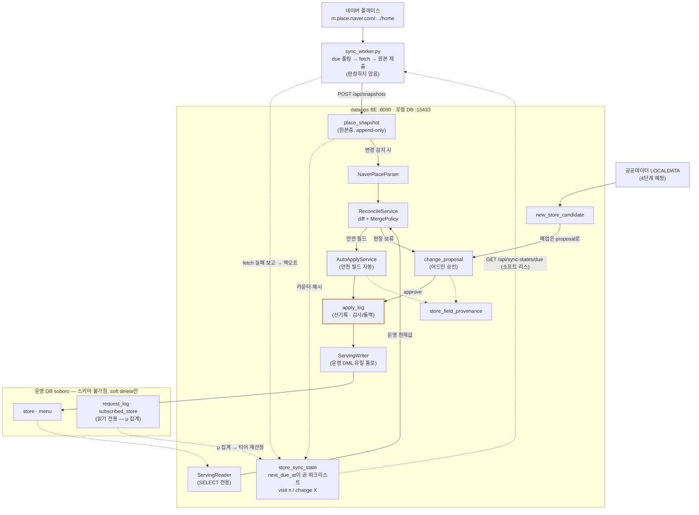

# 데이터 최신화 설계

Created: 2026년 7월 30일 오전 10:57
분류: 백엔드

<aside>
💡

**현재 상황:**

DB에 적재되어 있는 가게 45,444개의 최신화 업데이트 방안 탐색

- 가게의 폐업 여부
- 새로운 가게
- 메뉴 추가/수정/삭제
- 가격 변동

⇒ ~~점주 입력 채널~~, 유저 제보 미비 ⇒ 주체적인 최신화가 필요

</aside>

> ⚠️ **기존 dataops 코드는 전부 폐기.** 레포에 남아 있는 issue·ingest·remedy·crawltask 도메인(과 그 테이블·crawl_worker.py)은 이 설계와 무관 — 참조·확장 금지. 이 문서 기준으로 새로 만든다.

# 생각한 방법

1. 주기적인 크롤링
    - 시간이 많이 소요
    - 기기/IP 차단되면 방법이 없음
        - 찾아보니 IP를 우리 IP를 안쓰고 우회할 수 있는 유료 플랜 존재
    - 인스타로 메뉴정보, 운영여부를 정보를 가져오면 사용자에게 많은 도움을 줄 수 있을듯
2. 공공데이터 활용? [`행정안전부_식품_제과점영업 조회서비스`](https://www.data.go.kr/data/15155252/openapi.do#/API%20목록/info)
    - 업데이트가 매번 되는게 아니고, 분기별로 업데이트 하기에 최신화에 문제가 있을 수 있음
    - 메뉴는 따로 업데이트 해야함
    - 업종 커버리지 — "제과점영업"만 보면 카페형 빵집(휴게음식점·일반음식점으로 인허가받는 곳이 많음)을 놓침
    - 음식점 데이터를 상호 키워드("베이커리", "빵", "제과" 등)로 필터해 병행해야 함

# 현재 데이터 분석 결과

|  | **규모** | **문제** | **해결방법** |
| --- | --- | --- | --- |
| **네이버와 연결 안됨** | 14,500개(32%) | 네이버 place_id가 없어서 크롤 불가능 | 별도 작업 |
| **네이버와 연결됐지만, 메뉴 0개** | 6,641개 | 최신화 이전에 백필부터 채우기 | 크롤로 채우기 |
| **네이버와 연결됐고, 메뉴도 있음** | 24,276개 | ㄹㅇ최신화 필요 | 주기적 재확인 |

# 최신화 시스템 설계

```text
[외부 소스]          [원본층]           [판정층]              [서빙층]
네이버 크롤  ──┐
공공데이터   ──┼→  스냅샷 쌓기   →   지난번과 비교(diff)  ─┬→ 안전한 변경: 자동 반영 → store/menu
인스타(나중) ──┘   (원본 그대로)      + 병합 규칙 적용      └→ 애매한 변경: 어드민 승인함에 넣기
```



https://claude.ai/code/artifact/e8c45de1-4004-4596-9e2a-9ddca6613374

## 용어 미니 사전 (다이어그램 읽기 전에)

| 용어 | 뜻 |
| --- | --- |
| due | `next_due_at <= now`인 가게 — "다시 볼 때가 된 곳". 이 목록이 곧 작업 큐 (별도 큐 테이블 없음) |
| 티어 | 방문 주기 등급 — T0(구독·조회 상위 ~1,200곳, 주 2회) / T1(나머지 매칭 가게, 주 1회) |
| μ (수요 신호) | 가게별 조회수·구독수 — request_log 집계 (⚠️ 어드민 경로·팀 계정 7개 제외 필터 필수) |
| 소프트 리스 | due 배부 시 last_attempt_at 스탬프 → 2시간 중복 배부 방지. 겹쳐도 크롤이 멱등이라 무해 |
| provenance | 필드 단위 출처 기록 — "이 값은 누가 넣었나" |
| apply_log | 운영 DB에 쓰기 전, 전/후 값을 먼저 남기는 감사 로그 |

## 어디서 도는가 — 운영 모델

- **상시 서버 없음.** 노트북에서 dataops 서버(:8090) + 도커 DB(:15433) + 워커를 켤 때 도는 **세션형**
    - due 기반이라 cron 불필요 — 언제 켜든 가장 밀린 가게부터, 도중에 꺼도 정리할 게 없음
    - 주간 필요량: 32,100 요청 × 1.5초 ≈ **13.4시간/주** (예: 주 2회 밤새 실행)
- **상시화 전환 신호**: overdue(주기보다 밀린) 가게 수가 주 단위로 계속 늘면 → 작은 상시 호스트로 이전. **코드·스키마 변경 0** (같은 프로세스를 cron으로 켤 뿐)
- 저장 배치: 스냅샷은 로컬 도커 DB(부피 큼·잃어도 재수집 가능), 소형 테이블(apply_log·provenance·sync_state·proposal — 합계 수십 MB)은 **3단계에 RDS `dataops` 스키마로 승격** → apply_log+운영 DML이 단일 트랜잭션이 되고 백업 문제도 해소

- 실행 예시
    1. 주기에 따라 크롤링 진행
        - 운영중인 가게 중 스케줄링을 해야 하는 가게 리스트를 뽑아서 크롤링 리스트를 만든다
        - 크롤링
    2. 원본층
        - 크롤링 데이터 해시값을 비교하여, 업데이트된 정보인지 아닌지 판단
        - 업데이트된 정보면, 원본 저장(`place_snapshot` 테이블)
            - 해시값이 같다면 저장X
    3. 판정
        - 크롤링 데이터에서 필요한 데이터 파싱
            - 영업시간, 메뉴, 인스타 아이디
        - 파싱값 vs 기존값(운영데이터) 비교
        - 병합 정책에 맞게 업데이트하기
            - 가격 변경 · 신규 메뉴 · 영업시간 → AUTO (바로 반영)
            - 메뉴 소멸 · 가게명 · 주소 · 폐업 신호 → proposal (어드민 승인 대기)
            - 단, 상위 출처(ADMIN/USER)가 기록된 필드는 AUTO 대상이어도 proposal로 강등
    4. 반영/업데이트
        - AUTO는 바로 업데이트
        - PROPOSAL은 `change_proposal`테이블에  `PENDING`으로 적재
    5. Admin에서 반영
        - 개발자가 직접 반영할지 말지 판단 후 적용

## 1. 스케줄링

- 어떤 가게를 언제 다시 볼까?
- 언제 다시 볼지 기록할 컬럼 필요

## 2. 변경 감지

- 지난 번과 비교해서 뭐가 바뀌었나?
- 크롤 결과를 저장해둬야 비교 가능

## 3. 병합

- 바뀐 값을 반영할 때, 기존 값과 변경 값 중 어떤 걸 반영할 것인가?
- 크롤링한 값인지, 어드민에서 넣은 값인지 → 값의 출처를 알 수 없음

## 따라서 필요한 스키마 구조

### 원본층

- 크롤 결과를 원본 그대로 쌓아둠
    - 지난번과 비교가 가능해짐
- 스키마
    
    ```sql
    CREATE TABLE place_snapshot (
        id           BIGSERIAL PRIMARY KEY,
        store_id     BIGINT      NOT NULL,
        source       VARCHAR(20) NOT NULL,
        fetched_at   TIMESTAMP   NOT NULL,
        content_hash CHAR(64)    NOT NULL,
        payload      JSONB       NOT NULL,      -- 파싱 전 원본 (Apollo state 등)
        created_at   TIMESTAMP   NOT NULL DEFAULT now()
    );
    CREATE INDEX idx_snapshot_store ON place_snapshot (store_id, source, fetched_at DESC);
    ```
    

- 용량은? — **가게당 최신 1개 + proposal/apply_log가 근거로 참조하는 스냅샷만 보존**, 나머지는 주기 프루닝
    - 과거 스냅샷은 파이프라인 동작에 불필요 (변경 감지는 content_hash, diff는 운영 현재값과 대조)
    - 정상 상태 ~2~3GB에서 평탄 (TOAST 압축 기준)

### 스케줄 상태

- 가게와 소스별로 ‘마지막으로 본 시각, 다음에 볼 시각’을 기록
    - 스케줄러 테이블이 바라보는 테이블
- 스키마
    
    ```sql
    CREATE TABLE store_sync_state (
        id                   BIGSERIAL PRIMARY KEY,
        store_id             BIGINT      NOT NULL,           -- 운영 store.id
        source               VARCHAR(20) NOT NULL,           -- NAVER | LOCALDATA | INSTAGRAM
        external_id          VARCHAR(80),                    -- 소스별 id (naver_place_id, 인허가 관리번호…)
        tier                 VARCHAR(10) NOT NULL DEFAULT 'T1',  -- T0(주 2회) | T1(주 1회)
        state                VARCHAR(20) NOT NULL DEFAULT 'ACTIVE', -- ACTIVE | PARKED(: 수동지정,크롤 영구 제외) | UNLINKED(: place_id 만료)
        next_due_at          TIMESTAMP,                      -- 스케줄러는 이 컬럼만 본다
        last_attempt_at      TIMESTAMP,
        last_success_at      TIMESTAMP,
        content_hash         CHAR(64),                       -- 직전 성공 페이로드 SHA-256
        visit_count          INT NOT NULL DEFAULT 0,         
        change_count         INT NOT NULL DEFAULT 0,         
        consecutive_failures INT NOT NULL DEFAULT 0,
        created_at           TIMESTAMP NOT NULL DEFAULT now(),
        updated_at           TIMESTAMP NOT NULL DEFAULT now(),
        UNIQUE (store_id, source)
    );
    CREATE INDEX idx_sync_state_due ON store_sync_state (next_due_at) WHERE state = 'ACTIVE';
    CREATE INDEX idx_sync_state_store ON store_sync_state (store_id);
    ```
    

### 출처 기록

- 네이버에서 온 전화번호인지, 영업시간은 어드민에서 기록한 건지 출처를 기록해두면,
    - 어떤 데이터를 반영할건지 우위/규칙을 정할 수 있다
- **왜 필요한가 — 실측 사례**: DB에만 있는 메뉴 748개 중엔 **사용자 기여 메뉴(MENU_ADD 승인분)가 섞여 있다.** 출처 없이 재수집하면 네이버 기준으로 덮여서 사용자 기여가 소리 없이 사라진다
    - 그래서 시딩 때 사용자 기여 메뉴에 `USER`를 소급 기록하는 게 재수집의 **선행조건**
- 스키마
    
    ```sql
    CREATE TABLE store_field_provenance (
        store_id    BIGINT      NOT NULL,
        field       VARCHAR(40) NOT NULL,   -- 'phone' | 'business_hours' | 'menu.{menuId}.price' ...
        source      VARCHAR(20) NOT NULL,   -- ADMIN | USER | NAVER | LOCALDATA
        snapshot_id BIGINT,                 -- NAVER/LOCALDATA일 때 근거 스냅샷
        updated_at  TIMESTAMP   NOT NULL DEFAULT now(),
        PRIMARY KEY (store_id, field)
    );
    ```
    

### 승인 여부

- 변경된 데이터를 자동 반영하기 애매한 변경을 어드민 승인 권한으로 판단하기
- 스키마
    
    ```sql
    CREATE TABLE change_proposal (
        id          BIGSERIAL PRIMARY KEY,
        store_id    BIGINT      NOT NULL,
        target      VARCHAR(60) NOT NULL,   -- 'store.name' | 'store.status' | 'menu.{menuId}.price' ...
        old_value   JSONB,
        new_value   JSONB,
        source      VARCHAR(20) NOT NULL,   -- NAVER | LOCALDATA
        snapshot_id BIGINT,                 -- 근거 스냅샷
        status      VARCHAR(20) NOT NULL DEFAULT 'PENDING', -- PENDING|APPROVED|REJECTED|SUPERSEDED
        review_note VARCHAR(500),
        reviewed_at TIMESTAMP,
        created_at  TIMESTAMP   NOT NULL DEFAULT now(),
        updated_at  TIMESTAMP   NOT NULL DEFAULT now()
    );
    
    CREATE UNIQUE INDEX uq_proposal_pending ON change_proposal (store_id, target) WHERE status = 'PENDING';
    CREATE INDEX idx_proposal_status ON change_proposal (status, created_at);
    ```
    

### 신규 가게 후보

- 스키마
    
    ```sql
    CREATE TABLE new_store_candidate (
        id               BIGSERIAL PRIMARY KEY,
        mgmt_no          VARCHAR(60)  NOT NULL UNIQUE,  -- 인허가 관리번호 (중복 적재 방지 키)
        name             VARCHAR(100) NOT NULL,
        road_address     VARCHAR(200),
        jibun_address    VARCHAR(200),
        category_code    VARCHAR(40),                   -- 업종 (제과점영업/휴게음식점…)
        licensed_at      DATE,                          -- 인허가일
        status           VARCHAR(20) NOT NULL DEFAULT 'WAITING_NAVER',
                         -- WAITING_NAVER | MATCHED | REGISTERED | NOT_FOUND | REJECTED
        naver_place_id   VARCHAR(50),                   -- 매칭 성공 시
        match_attempts   INT NOT NULL DEFAULT 0,
        registered_store_id BIGINT,                     -- Store 생성 완료 시 운영 id
        created_at       TIMESTAMP NOT NULL DEFAULT now(),
        updated_at       TIMESTAMP NOT NULL DEFAULT now()
    );
    CREATE INDEX idx_candidate_status ON new_store_candidate (status);
    ```
    

### 반영 기록 (운영 쓰기 감사 로그)

- 운영 DB에 대한 **모든 쓰기는 예외 없이 여기 먼저 기록하고 실행**한다
    - 변경 전/후 값이 남아 사고 시 롤백 근거가 된다
    - admin API 같은 완충 없이 직접 DML을 하므로, 이 테이블이 **유일한 감사 장치**
- 스키마
    
    ```sql
    CREATE TABLE apply_log (
        id          BIGSERIAL PRIMARY KEY,
        store_id    BIGINT      NOT NULL,
        target      VARCHAR(60) NOT NULL,       -- change_proposal.target과 동일 체계
        old_value   JSONB,                      -- 쓰기 직전 운영 값 (롤백 근거)
        new_value   JSONB,
        origin      VARCHAR(20) NOT NULL,       -- AUTO | PROPOSAL
        proposal_id BIGINT,                     -- origin=PROPOSAL일 때
        snapshot_id BIGINT,                     -- 근거 스냅샷
        applied_at  TIMESTAMP   NOT NULL DEFAULT now()
    );
    CREATE INDEX idx_apply_log_store ON apply_log (store_id, applied_at DESC);
    ```
    

## 운영 DB 직접 쓰기 규율

| 규칙 | 내용 |
| --- | --- |
| 스키마 불가침 | 운영 DB에 DDL 금지. DML(INSERT/UPDATE)만, 물리 DELETE 금지(soft delete) |
| 유일 통로 | 운영 DML 코드는 ServingWriter 한 곳에만 존재. DB 계정도 store·menu INSERT/UPDATE로 권한 제한한 전용 계정(dataops_writer) |
| 전량 기록 | 쓰기 전 apply_log 선기록 — 예외 없음 |
| ⚠️ 팀 확인 필요 | 직접 DML은 본 앱의 부수효과(**OpenSearch 색인**·캐시)를 우회한다 — store/menu 변경이 검색 인덱스에 어떻게 반영되는지 **자동 반영 켜기 전에 확인 필수** |

# 적재된 데이터 최신화 → 크롤링

- 현재 사용중인 `Chromium` 을 사용중인 구조에서 모바일 플레이스 http 요청으로 파싱 변경
    - 모바일 플레이스 페이지는 서버에서 렌더링돼서, 응답 HTML 안에 데이터가 통째로 박혀 오기때문에,
    - `<script>window.**APOLLO_STATE** = { ... 가게정보·메뉴·영업시간·인스타링크 전부 ... }</script>`
    - 이 **APOLLO_STATE** 블록을 정규식으로 잘라내서 json.loads 해서 사용가능
    - 포함 데이터
        - Apollo state에 __typename: "Menu" 엔티티로 정규화돼 있습니다. DOM 셀렉터(a.xPf1B)를 파싱할 이유가 사라집니다.
        - 배달앱 메뉴가 덤으로 옵니다. 한 가게에서 PlaceDetail_BaeminMenu 64개 + BaeminMenuGroup 13개가 나왔습니다. 배민 연동 가게는 메뉴 소스가 하나 더 있는 셈입니다.
        - 영업시간
        - 인스타아이디
- 1.5초에 1개의 가게 긁었을 때 차단 X → 전체 가게 한바퀴 긁는데 약 19시간 소요

## 차단 문제 해결 어떻게 하지?

크롤링은 빨라진 만큼  빨리 돌리면 위험은 증가한다

- 스케줄링 Spot Instance EC2 사용
    - AWS는 자사 IP 대역 전체를 ip-ranges.json으로 공개한다. 누구나 다운받아서 "이 요청은 AWS에서 왔다"를 즉시 판정 가능
    - 스팟을 껐다 켜서 받는 새 IP는 같은 AWS 서울 대역 안에서 도는 것이라, 그 대역이 이미 플래그돼 있으면 몇 번을 바꿔도 그대로다.
    - 데이터센터 IP 로테이션이 통했다면 residential proxy 시장이 존재할 이유가 없다. 그 시장이 크다는 것 자체가 이 방법의 한계를 말해준다.
- [`Scrapling`](https://github.com/D4Vinci/Scrapling) 라이브러리 사용
    - **Scrapling** 문서에 "DNS-over-HTTPS로 프록시 사용 시 DNS 누출 방지" = 프록시는 네가 가져와라가 전제
    - **Scrapling**이 실제로 해결하는 건 지문 불일치이다
        - requests는 UA는 Chrome이라 말하면서 TLS 지문은 Python입니다.
        - Scrapling의 Fetcher가 TLS impersonation으로 그 간극을 메울 수 있다
        - 하지만 IP가 같으면 지문을 아무리 다듬어도 IP 기준 차단은 그대로 걸린다
- 더 많이 긁을 방법을 찾자"가 아니라 **"덜 긁어도 되게 하자”**
    - 가게별 조회수(로그테이블 기반) 높은 가게 우선 크롤링
    - 나머지 크롤 가능 가게 주 1회? → 사용자 트래픽이 증가하면 다시 확인하기

# 인스타 공지 메뉴 → 크롤링

- 메뉴, ~~품절~~, 임시 휴무 등 정보
- 인스타 메뉴 테이블로 분리
    - 지금(일시적) 상태 vs 상시 속성을 분리

```sql
┌─────────────┬─────────────────────────┬─────────────────────────────────────────┐
│             │         네이버          │                 인스타                  │
├─────────────┼─────────────────────────┼─────────────────────────────────────────┤
│ 데이터 성격 │ 상시 메뉴 목록 (roster) │ 오늘의 상태 / 이벤트                    │
├─────────────┼─────────────────────────┼─────────────────────────────────────────┤
│ 수명        │ 몇 달                   │ 몇 시간~며칠                            │
├─────────────┼─────────────────────────┼─────────────────────────────────────────┤
│ 구조        │ name, price 필드        │ 자유 텍스트 + 이미지                    │
├─────────────┼─────────────────────────┼─────────────────────────────────────────┤
│ 예시        │ "소금빵 3,500원"        │ "오늘 소금빵 나왔어요 🥐 3시 완판 예상" │
└─────────────┴─────────────────────────┴─────────────────────────────────────────┘
```

- 인스타 Id 적재 후, 정보성 피드를 올리는 가게 위주 크롤링
    - 공식 Instagram Graph API
        - Business Discovery API로 공개 비즈니스 계정의 프로필·최근 미디어(캡션, 타임스탬프, 이미지 URL)를 합법적으로 가져올 수 있다
        - 조건: Meta 앱 심사 필요, 대상 계정의 정확한 username을 알아야 함(검색 불가), 페이스북 페이지 연동된 계정
    - 외부 벤더사 이용(Apify, Bright Data, EnsembleData, HikerAPI, ScrapeCreators 등)
- 무료 플랜으로 인기있고, 메뉴 최신화가 매일(주기적으로) 올라오는 가게 위주 크롤링

# 폐업/신규 최신화 → 공공데이터

- 크롤링으로는 폐업 여부를 파악할 필드가 존재 X
    - 크롤링 시 페이지 404가 뜨면 폐업으로 판단할 수 있지만, 실제 데이터 관측된게 없음

# 진행 방법 — 단계별 게이트

| 단계 | 내용 | 다음 단계 조건 |
| --- | --- | --- |
| **0** | 기존 dataops 도메인 폐기 + 새 스키마 6개 + sync/snapshot 도메인 + sync_worker.py + 시딩(사용자 기여 메뉴 `USER` 소급 포함) | 시딩 수 = 매칭 가게 수 일치, 표본 100곳 수집 성공 |
| **1** | **관찰 모드** — 1,000곳만 스냅샷·해시·카운터 (판정 미가동) | 1주 무차단 완주, 파서 정합성 눈검사 |
| **2** | 판정 가동 — **전 필드 proposal** (자동 반영 0, 운영 쓰기는 승인 건만) | proposal 표본 검수로 오탐률(오매칭발 diff) 확인 |
| **3** | 안전 필드 자동 전환 + 전체 확대 — **첫 완주가 곧 백필 스윕** (메뉴 0개 ~3,170곳 / ~32,000메뉴). 소형 테이블 RDS 승격 | OpenSearch 색인 확인 완료, 자동 반영 오류 0 |
| **4** | 공공데이터 파일럿 — 신규 인허가 적재 + 폐업 proposal | 매칭률 실측으로 계속/중단 판단 |

**별도 트랙** (이 파이프라인 밖):

- 네이버 place_id 없는 가게 **14,500개(32%)** → 매칭 작업으로만 해결됨 (크롤 스케줄링 개선과 무관). 백필 진행하며 차단 여부 확인

# 데이터 병합 정책

- 우선순위: **ADMIN > USER > NAVER**
- 상위 출처가 기록된 필드에 하위 출처 diff가 오면 → 자동 반영 금지, `change_proposal`로 저장

| **필드(target)** | **출처 동급/하위일 때** | **이유** |
| --- | --- | --- |
| `store.business_hours` | **자동 반영** | 낡은 값의 피해가 크고, 네이버가 사실상 원천 |
| `store.phone` | **자동 반영** | 동일 |
| `menu.{id}.price` | **자동 반영** | 가격 개정은 빈번·기계적 |
| 신규 menu 추가 | **자동 반영** (기존 enrich와 동일 성격) | backfill과 동일 로직 |
| `store.name` | **proposal** | 오매칭 신호일 수 있음 |
| menu 소멸 (네이버에서 사라짐) | **proposal** | 품절/페이지 개편/오매칭 구분 불가 — 자동 삭제 금지 |
| `store.status` (폐업·휴업 신호) | **proposal** | 네이버 단일 신호로 판정 불가 |
| `store.address`/좌표 | **proposal** | 이전(移轉)과 오매칭 구분 필요 |
| 인스타 핸들 (신규 발견) | **자동 반영** — 단 서빙층에 컬럼이 없으므로 은 `store_sync_state(source=INSTAGRAM).external_id`에만 저장 |  |