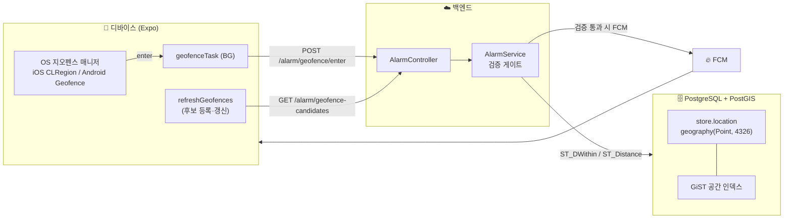
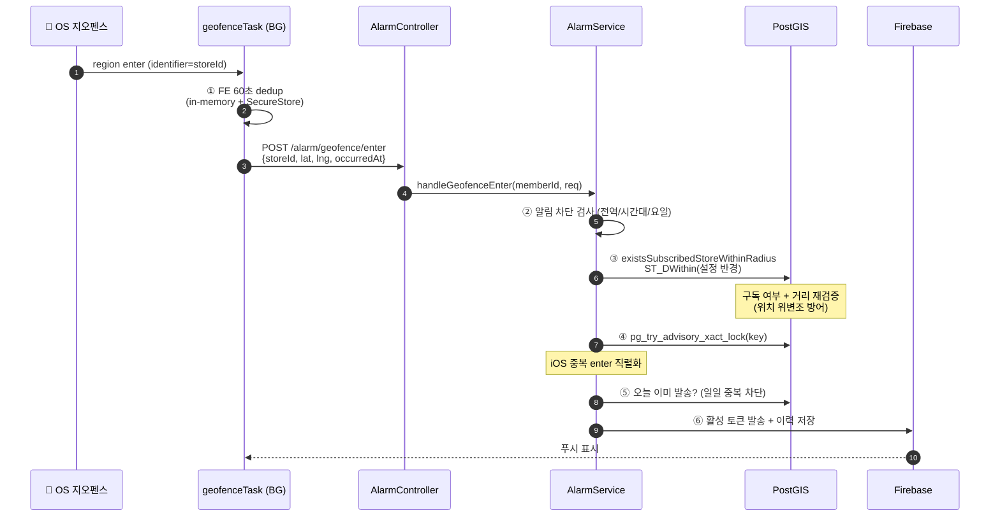
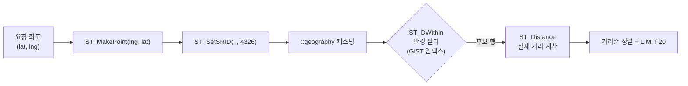
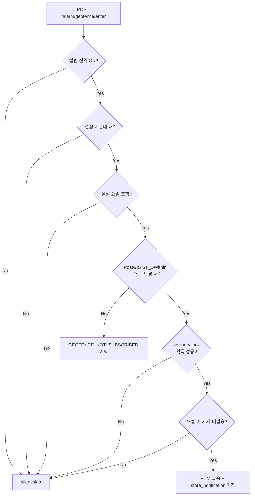
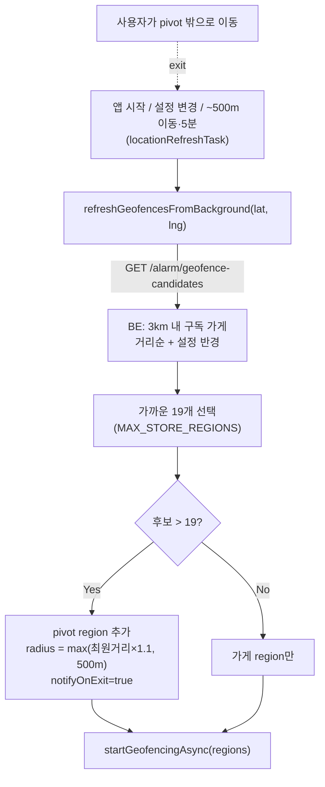
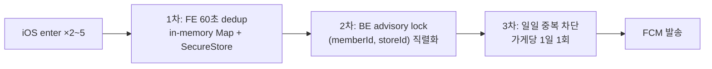
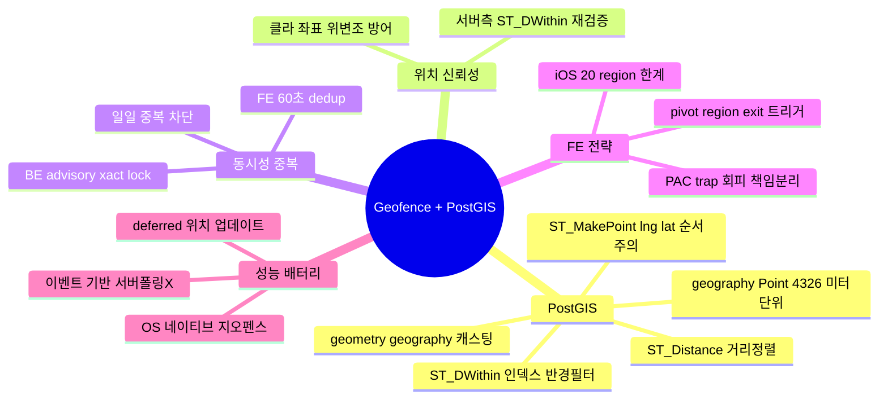

# Geofencing & PostGIS 아키텍처

> 빵긋(Bbang-ggut) — "근처 빵집 알림"의 **위치 기반 지오펜스 + PostGIS 공간 쿼리** 중심 정리
>
> 스택: PostgreSQL + **PostGIS** · Spring Boot (Hibernate Spatial / JTS) · Firebase FCM
> FE: Expo SDK 54 · expo-location (OS 네이티브 지오펜스) · expo-task-manager

---

## 1. 핵심 설계: 왜 이벤트 기반 지오펜스인가

서버가 사용자 위치를 주기적으로 폴링하지 않는다. **OS 네이티브 지오펜스**가 "진입(enter)"을 감지하면 앱이 서버에 보고하고, 서버는 **PostGIS로 거리를 재검증**한 뒤 푸시를 보낸다.



| 비교 | 서버 폴링 방식 | **이벤트 기반 지오펜스 (채택)** |
|---|---|---|
| 위치 수집 | 앱/서버가 주기적 GPS | OS가 region 경계 감지 시에만 |
| 배터리 | 높음 | 낮음 (OS 최적화 위임) |
| 서버 부하 | 상시 위치 수신 | 진입 시점에만 요청 |
| 신뢰성 | 클라 좌표 신뢰 | **서버가 PostGIS로 재검증** |

---

## 2. 지오펜스 알림 — End-to-End



---

## 3. PostGIS 깊이 보기 ⭐ (핵심)

### 3-1. 위치 컬럼 — `geography(Point, 4326)`

```java
// Store.java
@Column(nullable = false, columnDefinition = "geography(Point, 4326)")
private Point location;   // org.locationtech.jts.geom.Point (JTS)
```

- **`geography`** 타입: 위경도를 지구 타원체 위 좌표로 보고, **거리 계산이 자동으로 미터(m) 단위**. 지구 곡률을 반영하므로 한국처럼 위도가 있는 지역에서도 정확.
  - 비교: `geometry`는 평면 좌표 → 거리가 "도(degree)" 단위라 미터로 쓰려면 별도 변환 필요.
- **`Point`**: 단일 좌표점. **`4326`** = WGS84(GPS 표준 좌표계) SRID.
- ORM: Hibernate Spatial + JTS(`org.locationtech.jts`)로 매핑.

### 3-2. 쿼리 ①: 지오펜스 후보 조회 (반경 3km 내 구독 가게)

OS에 등록할 region 후보를 거리순으로 최대 20개 반환한다.

```sql
SELECT
  s.id   AS "storeId",
  s.name AS "storeName",
  ST_Y(s.location::geometry) AS "latitude",    -- 위도 추출
  ST_X(s.location::geometry) AS "longitude",   -- 경도 추출
  ST_Distance(                                  -- 실제 거리(m) → 정렬용
    s.location,
    ST_SetSRID(ST_MakePoint(:lng, :lat), 4326)::geography
  ) AS "distanceMeters"
FROM subscribed_store ss
JOIN store s ON ss.store_id = s.id
WHERE ss.member_id = :memberId
  AND s.status = 'ACTIVE'
  AND ST_DWithin(                               -- 반경 필터 (인덱스 사용)
        s.location,
        ST_SetSRID(ST_MakePoint(:lng, :lat), 4326)::geography,
        :candidateRadius                        -- 3000.0 (m)
      )
ORDER BY "distanceMeters" ASC
LIMIT 20;
```

### 3-3. 쿼리 ②: 진입 검증 (구독 + 반경 내인지 재검증)

`enter` 보고가 오면, 그 가게가 **내 구독 가게이고** 요청 좌표가 **설정 반경 안**인지 확인. 클라이언트 좌표를 신뢰하지 않는 위변조 방어선.

```sql
SELECT EXISTS (
  SELECT 1
  FROM subscribed_store ss
  JOIN store s ON ss.store_id = s.id
  WHERE ss.member_id = :memberId
    AND s.id = :storeId
    AND s.status = 'ACTIVE'
    AND ST_DWithin(
          s.location,
          ST_SetSRID(ST_MakePoint(:lng, :lat), 4326)::geography,
          :radius            -- 사용자 설정 반경 (R100~R1000)
        )
);
```

### 3-4. PostGIS 함수 정리 + 자주 하는 실수

| 함수 | 역할 | 주의점 |
|---|---|---|
| `ST_MakePoint(:lng, :lat)` | 좌표점 생성 | ⚠️ **경도(X), 위도(Y) 순서** — `lat, lng`로 넣으면 엉뚱한 위치 |
| `ST_SetSRID(p, 4326)` | 좌표계(SRID) 지정 | 지정 후 `::geography` 캐스팅해야 미터 단위 연산 |
| `ST_DWithin(a, b, d)` | a~b 거리 ≤ d ? | geography면 d는 **미터**. **GiST 인덱스를 타서 빠름** → 반경 검색에 최적 |
| `ST_Distance(a, b)` | 실제 거리(m) | 모든 행 계산 → 필터는 `ST_DWithin`, 정렬·표시는 `ST_Distance` |
| `ST_X / ST_Y` | 경도 / 위도 추출 | geography엔 직접 불가 → `::geometry` 캐스팅 후 사용 |

> **설계 의도**: 필터링은 인덱스를 타는 `ST_DWithin`으로 후보를 좁히고, 좁혀진 행에 대해서만 `ST_Distance`로 실제 거리를 계산해 정렬한다. 전체 테이블에 `ST_Distance`를 돌리는 것보다 훨씬 효율적.



---

## 4. 서버측 검증 게이트 + Advisory Lock

`handleGeofenceEnter`는 여러 관문을 통과해야만 푸시를 보낸다.



### Advisory Lock — 동시성 제어

iOS region monitoring은 같은 enter를 **2~5회** 짧은 간격으로 발화한다. 동시에 서버에 도달하면 중복 푸시가 나갈 수 있어, `(memberId, storeId)` 단위로 트랜잭션 락을 건다.

```java
// 두 ID를 64bit 키 하나로 결합
long lockKey = (memberId << 32) | (store.getId() & 0xFFFFFFFFL);
if (!storeNotificationRepository.tryAdvisoryXactLock(lockKey)) {
    return; // 다른 트랜잭션이 같은 키 처리 중 → silent skip
}
```
```sql
SELECT pg_try_advisory_xact_lock(:key)   -- non-blocking, 트랜잭션 종료 시 자동 해제
```

- **`pg_try_advisory_xact_lock`**: 즉시 시도(non-blocking). 이미 잠겨 있으면 `false` 반환 → 대기 없이 skip.
- **`_xact_`**: 트랜잭션 스코프 → 커밋/롤백 시 자동 해제 (명시적 unlock 불필요).
- 테이블 락이 아닌 **애플리케이션 레벨 논리 락**이라 가볍다.

---

## 5. FE 지오펜스 등록 전략 (iOS 20-region 한계)

iOS는 동시에 모니터링 가능한 region이 **하드 리밋 20개**. 그래서 **가까운 19개 가게 + pivot region 1개** 전략을 쓴다.



- **pivot region**: 사용자를 둘러싼 큰 원. **enter 알림용이 아니라 exit 트리거 전용** (`notifyOnEnter:false, notifyOnExit:true`). 벗어나면 region 목록을 새 위치 기준으로 다시 짠다 (Apple 공식 샘플 패턴).
- pivot 반경: 가장 먼 가게까지 거리 × 1.1, 최소 500m (haversine으로 계산).

### ⚠️ 트러블슈팅 — PAC trap 크래시

> geofence 콜백 **안에서** `startGeofencingAsync(GEOFENCE_TASK_NAME)`를 호출하면, `EXTaskService`가 실행 중인 자기 자신을 재등록하면서 **use-after-free → PAC trap 크래시**가 발생했다.
> **해결**: region 갱신을 enter 콜백에서 분리하고, 별도 `locationRefreshTask`(500m/5분 주기)에 위임. enter 콜백은 "보고"만, region 재등록은 "위치 갱신 태스크"만 담당하도록 책임 분리.

---

## 6. 다단계 중복 제거 (3중 방어)

iOS의 중복 enter 발화를 세 겹으로 막는다.



| 층 | 위치 | 방어 대상 |
|---|---|---|
| 1차 | FE `geofenceTask` | 같은 프로세스 즉시 중복 + cold-start 후 중복 (60s TTL) |
| 2차 | BE advisory lock | 서버에 **동시 도달**하는 요청(경쟁 조건) 직렬화 |
| 3차 | BE 일일 중복 | 시간차 재진입 시 같은 가게 하루 1회로 제한 |

> SecureStore 실패 등으로 FE dedup이 새도, BE 2·3차가 받쳐준다 (방어선 다중화).

---

## 7. 핵심 설계 포인트 요약



---

## 8. 주요 파일 레퍼런스

### 백엔드 (`bbang-ggut_BE`)
| 파일 | 핵심 |
|---|---|
| `store/entity/Store.java` | `geography(Point, 4326)` location 컬럼 (JTS Point) |
| `store/repository/SubscribedStoreRepository.java` | **`findGeofenceCandidates`(ST_DWithin/ST_Distance), `existsSubscribedStoreWithinRadius`** |
| `alarm/service/AlarmService.java` | `handleGeofenceEnter`(검증 게이트), `getGeofenceCandidates`, advisory lock |
| `alarm/repository/StoreNotificationRepository.java` | `tryAdvisoryXactLock`(pg_try_advisory_xact_lock), 일일 중복 체크 |
| `member/enums/NotificationRadius.java` | R100~R1000 반경 단계 |

### 프론트엔드 (`bbang-ggut_FE/bbanggut`)
| 파일 | 핵심 |
|---|---|
| `src/tasks/geofenceTask.ts` | OS enter 핸들러 + 60초 dedup, PAC trap 회피 주석 |
| `src/tasks/refreshGeofences.ts` | 후보 fetch + region 등록, **pivot region 로직(haversine)** |
| `src/tasks/locationRefreshTask.ts` | 저전력 위치 폴링 → region 갱신 트리거 |
| `src/utils/alarmSetup.ts` | 지오펜싱 시작/중지, 권한, 백그라운드 위치 |

---

## 9. 내가 맡은 역할 (발표용 — 직접 채우기)

> 담당 범위에 맞게 수정하세요.

- **담당 영역**: (예: 백엔드 지오펜스 + PostGIS 공간 쿼리 설계)
- **설계 기여**:
  - PostGIS `geography(Point,4326)` 기반 반경 검색 — `ST_DWithin`(인덱스 필터) + `ST_Distance`(정렬) 분리로 성능 확보
  - 클라 좌표 위변조 방어용 서버측 거리 재검증 게이트
  - `pg_try_advisory_xact_lock`으로 iOS 중복 enter 동시성 제어
- **트러블슈팅**:
  - iOS enter 2~5회 중복 → FE 60초 dedup + BE advisory lock + 일일 중복 3중 방어
  - (FE) geofence 콜백 내 재등록 → PAC trap 크래시 → 책임 분리로 해결
- **결과**: 서버 폴링 없이 이벤트 기반 동작, 인덱스 기반 공간 쿼리로 빠른 반경 검색
